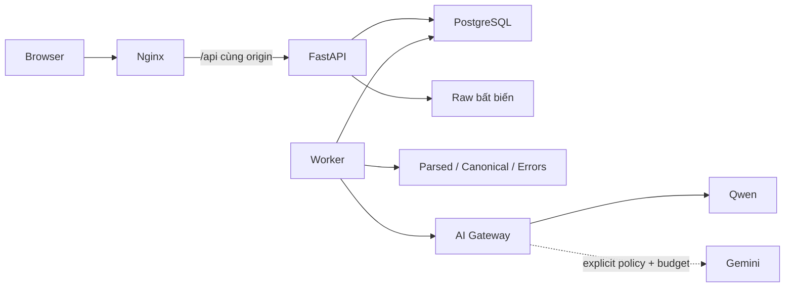

# Kiến trúc ứng dụng

**Kiểm toán 08/11/2026 — binding nguồn Planner:** compiler giữ xác nhận theo đúng cặp canonical có revision, chặn thay tệp được nhắc tường minh bằng nguồn khác, và chỉ cấp capability dùng lại run khi có scope hiện hành đã duyệt. Wire gọn của Ollama chỉ là cách truyền nội bộ cho Planner; Backend mở rộng về cùng DTO trước validation. Không thêm gateway, service, migration, thư viện hoặc công thức tài chính. Lỗi Ollama được ghi `BLOCKED` ở cả job và attempt; reservation và quy tắc không gửi lại delivery unknown giữ nguyên. Chi tiết ở [hợp đồng dữ liệu](DATA_CONTRACTS.md).

`tools/start.ps1` chặn build thông thường khi build inputs chưa commit, vì nhãn Git của Buildx có thể chỉ ghi HEAD trong khi source đã thay đổi. Ứng viên nghiệm thu chưa commit phải có nhãn theo hash nội dung và đối chiếu source/image/HTTP riêng, không được mô tả là image của commit gốc. Khi đã commit và đạt cổng phát hành, build thông thường dùng revision Git. Cùng một Compose project, volumes và quy trình xác minh loopback được bảo toàn.

**Bổ sung 08/11/2026 — mapping đa ngôn ngữ và phạm vi đọc trong Chat.** `field_name_tokens` dùng bộ từ vựng Việt–Anh có giới hạn cho đề xuất và kiểm chứng cột. Cột tiền tệ có bằng chứng được nối vào đích `currency` của bản nháp để giữ kiểm tra từng dòng. Người dùng có thể khai báo facts chung cho nhiều nguồn trong phạm vi các thẻ hiện hành. Mỗi nguồn vẫn có khóa, preflight và quyết định phê duyệt riêng.

Typed routing nhận metadata chuẩn bị cùng các refs đọc đã được kiểm quyền. Schema provider giới hạn tầng tường minh và các giá trị cố định. Với Gemini có nhiều ngữ cảnh nguồn, một cấu trúc query gửi danh sách ID giới hạn, còn compiler kiểm trường, metric và khả năng đọc theo ref được chọn. QuerySelection của trang đang xem tiếp tục ghim phạm vi xuất CSV/XLSX. Yêu cầu kỳ khác hoặc điều kiện thuộc hồ sơ ngoại lệ được hỏi rõ trước khi đọc nhóm giao dịch. Các ranh giới chi tiết được ghi trong [hợp đồng dữ liệu](DATA_CONTRACTS.md).

**Bổ sung 07/11/2026 — tích hợp hành trình Chat:** giao diện mở vào AI Assistant, giữ Dữ liệu/Đối soát/Báo cáo để quản lý hoặc kiểm tra sâu theo yêu cầu tự động hóa mới tại [PROJECT_PLAN.md](PROJECT_PLAN.md). Upload Chat không có câu hỏi dùng `PREPARE_UPLOAD` để đọc/profile/chuẩn bị và tạo draft; mapping chưa đủ nghĩa nghiệp vụ vẫn chờ duyệt. Batch review dùng transaction và hợp đồng quyết định hiện có cho từng resource. Planner dùng candidates Backend đã kiểm, xác nhận kỳ/coverage và business approval trước engine; top-N/ordinal/export lấy QuerySelection và verified snapshot, không tính tiền trong model hay frontend.

Chuẩn hóa thủ công và Chat dùng cùng nguồn sự thật. Khi canonical được công bố, transaction enqueue lượt `agent_resume` có giới hạn chỉ đọc nguồn đã duyệt. Nó kiểm quyền, khóa nguồn và chuyển các thẻ chờ tương ứng sang hết hiệu lực, bảo toàn draft/audit; Worker khởi động lại bù tín hiệu cho thẻ lịch sử theo khóa idempotency. Không gọi model, duyệt hoặc chạy normalization mới ở lượt bù. Worker dùng một executor inference và vòng công việc xác định để parse/query/normalize/reconcile/export không chờ inference dài. Không có service, bảng metadata hoặc framework Agent mới.

Danh mục canonical và reconciliation templates trả cursor để các bộ chọn đọc đủ metadata. Cặp canonical đã chọn được kiểm trực tiếp theo workspace/project/ID, độc lập với giới hạn trang. Các hợp đồng cụ thể nằm trong [DATA_CONTRACTS.md](DATA_CONTRACTS.md); tình trạng LOCAL/MOCK/LIVE và giới hạn provider ở [IMPLEMENTATION_STATUS.md](IMPLEMENTATION_STATUS.md), không suy nghiệm thu từ mô tả kiến trúc.

Upload CSV/XLSX công bố thêm bản tự chuẩn bị, gồm Parquet và thống kê theo cột, cùng giao dịch công bố bảng đã đọc. Tham chiếu prepared gắn với đúng artifact nguồn và có checksum riêng. Chuẩn bị [D] duyệt toàn bộ cột có dạng ngày ISO, kiểm tra chuyển ngược từng giá trị và giữ nguyên vị trí dòng. Chi phí tối đa O(dòng × cột). Dữ liệu có warning trích xuất hoặc ngày sai giữ kiểu chuỗi. Các trạng thái nghiệp vụ tiếp tục đi qua mapping và chuẩn hóa đã duyệt. Xem [hợp đồng dữ liệu](DATA_CONTRACTS.md).

**Bổ sung06/11/2026 — hardening đang nghiệm thu:** sửa parser có revision riêng; review từng phần được kiểm kiểu trước hợp nhất rồi tái kiểm source ở bước công bố. Draft-save/renew và đọc review theo bảng dùng `AgentWorkflowRow` hiện có, cùng owner/source locks/nonce/fingerprint; không thêm bảng, service hoặc bộ compiler. Receipt duyệt thủ công dùng audit và advisory transaction lock hiện có. Preview plan được lắp từ PlanningRequest và PlanningSuggestions tại một hàm dùng chung, sau đó vẫn qua validator nghiệp vụ. Các phép tính tài chính, Matcher và Verifier giữ nguyên. Trạng thái kiểm chứng hiện hành ở báo cáo triển khai; không đồng nhất bổ sung code với nghiệm thu sản phẩm toàn bộ.

| Ranh giới audit | Module và bằng chứng kiểm tra |
| --- | --- |
| Tải, lưu, đọc nguồn | `access`, `api`, `storage`, `parsing`, `document_parser`, `worker`. Kiểm scope, định dạng, giới hạn, checksum và vị trí nguồn; replay CSV/XLSX và bằng chứng tài liệu đã lưu |
| Profile, ánh xạ, chuẩn hóa | `profiling`, `mapping_verification`, `schema_mapping`, `normalization`, `date_parsing`. Kiểm lỗi/null/zero, khóa, tiền tệ, ngày, tiền Decimal, revision và artifact; đối chiếu 5.487 dòng TEST với đáp án độc lập |
| Quy tắc, đối soát, kiểm chứng | `reconciliation_*`, `verification`, `data_query`. Kiểm canonical revision, coverage, cardinality, tổng có dấu, nguồn và run; kiểm đối chiếu oracle và hồi quy nhiều ngành |
| Hội thoại và AI | `assistant_*`, `agent_*`, `ai_gateway`. Kiểm loại tool theo intent, ID nguồn, review, scope, trạng thái lỗi, model bind và giữ ledger khi lần gửi chưa rõ |
| Trình duyệt và vận hành | `App`, `AssistantStudio`, `ReviewCard`, `MappingStudio`, `navigation`, Docker và tools. Kiểm focus, resize, reload, dữ liệu trong hai màn hình, health, backup và rollback |

**Bổ sung05/11/2026 — ngày và Smart Mapping:** mở rộng profiler/Agent/compiler hiện có. `date_parsing` kiểm quy tắc ngày và timezone trước lặp dòng, alias hiển thị hữu hạn, DST/offset không bị bỏ qua. `mapping_verification` tái sử dụng compiler và normalization trong bộ nhớ để kiểm toàn bảng; không có engine chuẩn hóa thứ hai, approval giả được lưu hoặc artifact preview được công bố. Hai endpoint preflight cùng auth/scope/checksum; approval kiểm lại nguyên tử. Metadata mới additive trên DTO/JSON, không migration. Review thu gọn và phản hồi preflight được bind với đúng draft, request cũ abort khi sửa/rời màn hình. Giữ ngày là timestamp theo contract đã duyệt; field tiền đơn currency được giải thích rõ khi nguồn có nhiều tiền tệ. Docker build kiểm IANA UTC/Việt Nam/New York; image hiện tại đã có CSDL hệ thống, thiếu gói Python tzdata không tự chứng minh thiếu timezone.

**Bổ sung04/11/2026 — product polish:** request ceilings local có kiểu nullable, audit và quyền cloud độc lập; per-attempt receipts giữ token/status/latency/model, delivery chưa rõ không resend. Routing27 giữ source/effective facts vào PlanningRequest, không suy coverage từ kỳ; reuse từ chối facts mâu thuẫn. Chat nền trắng, menu tin nhắn dùng grid thay float; preview10dòng và chi tiết cùng query, pagination/source provenance không đổi. Backend/Worker phải build lại vì source đã đổi trong nhiệm vụ này; các mốc giữDAC bên dưới là lịch sử, không là runtime hiện tại. Matcher/Verifier/Decimal/storage/approvals không đổi.

Data Foundation và Reconciliation đã nghiệm thu theo [kế hoạch](PROJECT_PLAN.md). Assistant đã hợp nhất main tiêu thụ các contracts hiện có; không viết lại engine hay verifier. Bằng chứng, giới hạn và trạng thái release hiện hành tại [báo cáo triển khai](IMPLEMENTATION_STATUS.md).

## Contextual Assistant

Giao diện tối giản 04/11/2026 chỉ bổ sung input modality ở App Shell: pointer và Tab/Escape cập nhật thuộc tính trình bày, không gửi API hoặc thay orchestration. Composer không dùng `:focus-visible` đơn lẻ để suy bàn phím vì Chromium cũng áp dụng trạng thái này cho textarea được click chuột; keyboard focus dùng một inset underline, các controls/dialogs giữ focus indicator. CSS dùng chung neutral surface/border/shadow tokens; ranh giới trường nhập và bảng còn nguyên. Backend/Worker giữ image `dac8dd1` nếu source bytes vẫn khớp; chỉ frontend được build/recreate khi TypeScript/CSS thay đổi. Không gắn revision giả lên image cũ để tạo cảm giác đồng bộ.

Hoàn thiện giao diện 02/11/2026: `WorkspaceSettings.tsx` tách phần trình bày chỉ đọc khỏi App, gom tài khoản/quyền riêng tư/giới hạn theo một cột; Theo chỉ dẫn04/11, bỏ hẳn thông tin vận hành cho mọi role, kể cả owner; chỉ giữ nội dung tài khoản/quyền riêng tư/giới hạn tệp và khả dụng AI dành cho người dùng. Composer một hàng tự giãn, focus bàn phím tại control, dùng giới hạn chat từ Settings API chung với server validation. Không thêm service/framework, không thay orchestration, matcher/verifier, storage hoặc approvals.

Upload chưa nhận được phản hồi giữ idempotency key và chữ ký SHA256 theo actor/project trong sessionStorage. Hash tuần tự từng tệp, giữ thứ tự/tên trong chữ ký, không lưu raw bytes; refresh cần đính kèm lại đúng tệp rồi mới reuse key. Server tiếp tục kiểm bytes/scope và trả cùng bootstrap project/dataset. Biểu đồ có tên nhóm dài/nhiều nhóm dùng thanh ngang, nhãn xuống dòng và vùng cuộn bàn phím; giá trị chính xác/đơn vị vẫn từ DTO, không tính lại bằng frontend.

Data drawer reset bảng/revision/filter/preview cùng thao tác đổi nguồn hoặc nhận bảng mới, thay effect reset sau render để không xóa revision người dùng vừa chọn. Chọn lại cùng nguồn giữ lựa chọn; request nguồn cũ vẫn được abort. Không thay artifact hoặc mapping lịch sử.

Theo yêu cầu Product UX ngày 30/10/2026, Assistant là trang trong AppShell, thay panel tại kế hoạch §28; không thêm router hoặc implementation chat thứ hai. History API lưu identifiers trong URL, API xác minh quyền khi khôi phục; bản nháp theo actor/scope nằm trong sessionStorage của tab. Reconciliation giữ state khi đi sang Assistant và trở về, không dựng lại engine hoặc tính KPI ở frontend.

`assistant_tools.py` chỉ đọc theo actor/workspace/project/explicit run; `assistant.py` kiểm và render claims từ `AnswerFactSet`. `assistant_api.py` dùng auth/session/Origin hiện có. Hai bảng additive `conversations`/`conversation_messages` lưu context cố định theo hội thoại, messages, facts và citations; mỗi actor chỉ xem hội thoại của mình. Đổi run/group tạo hội thoại mới. Pagination dùng `(created_at,id)` và scoped cursor.

Messages vào queue PostgreSQL hiện có, không có queue/service mới. `assistant_jobs.py` dùng lease/fencing, membership và tombstone kiểm lại trước atomic publish; unique `(job_id,role)` và response ID xác định ngăn nhân đôi. Reclaimed job đã có provider reservation bị giữ `AI_DELIVERY_UNKNOWN`, không resend. Durable task ceiling bổ sung, không thay global/workspace Gemini budgets. Trace lưu actual usage khi có receipt, thiếu token/cost để null; failure chỉ ghi reservation đã biết, không bịa receipt.

Xóa hội thoại yêu cầu đúng actor và CSRF/Origin: xóa nội dung messages, giữ tombstone và audit; job payload không chứa câu hỏi/raw facts. Không tự xóa runs/rules/artifacts. Demo giữ hội thoại đến khi chủ hội thoại xóa; chưa có thời hạn retention tự động. Cache chỉ tái dùng deterministic answer đã verified khi câu hỏi/context/FactSet hash khớp, không cache proposal mơ hồ thành quyết định đã duyệt.

Workflow ngôn ngữ là đề xuất review, không là tool ghi. UI chọn hai hoặc ba nguồn READY, mẫu đã duyệt, kỳ/coverage và snapshot time cụ thể; ba nguồn tạo hai cặp theo rule, không JOIN ba nguồn. API reuse cũ kiểm signatures/semantics/effective dates và idempotency, trả PROPOSED. Người dùng mở kế hoạch, kiểm tra lại điều kiện, lưu và duyệt qua workflow Đối soát hiện có rồi mới chạy. Danh sách bản nháp có phân trang lấy từ PlanRow hiện có, chỉ của actor/project; không thêm workflow store. Shortlist trong câu trả lời không thay danh sách đầy đủ các mẫu đã duyệt hay kiểm quyền backend.

Migration `create_conversations` không đổi migrations cũ/runs/artifacts; downgrade từ chối bỏ hội thoại đã lưu. Rollback image main dùng override đã kiểm compatibility, bỏ riêng bước Alembic startup cũ vốn không biết revision mới; không downgrade DB. Backup drill dùng transaction snapshot, metadata phản chiếu schema hiện tại và published-file checksums; restore vào schema UUID trong PostgreSQL hiện có, đối chiếu toàn bộ metadata/hội thoại/quotas và từng file. Xem lệnh vận hành, copy backup ra host và giới hạn production tại [hướng dẫn kiểm thử và khôi phục](TESTING_GUIDE.md#quy-trình-kiểm-thử-và-khôi-phục-hiện-hành).

## Thành phần đang chạy

Hoàn thiện hội thoại 03/11/2026 giữ cùng orchestrator/queue. Clarification là cung cấp dữ kiện, không là approval: reply dùng scoped router, revalidate rồi advance; mapping/rule edits vẫn preview và quyết định riêng. Metric resolver ở data_query bind approved metric trước native query, không sửa Matcher/Verifier. Trang dữ liệu đang xem được lưu trong workflow JSONB tách khỏi blocks ban đầu; catalogue hỏi tiếp chỉ đọc cùng actor/conversation/nguồn còn hợp lệ. Frontend tách rendering clarification/approval, một composer có khóa gửi đồng bộ và icon loading cố định; timestamp/tool steps nằm trong phần mở rộng. Không thêm service/migration/dependency.



Một Compose project `ai-reconciliation-studio`, gồm `frontend`, `backend`, `worker`, `postgres`. Backend/worker dùng chung image và code. PostgreSQL giữ quan hệ, metadata, session, policy, jobs, attempts, approvals và audit. Volume `artifacts` giữ raw và Parquet. Không dùng database riêng cho từng upload; không dựng Redis, broker, model server hoặc container test.

## Ranh giới module

Document route dùng cùng upload/storage/jobs: JSON artifact bất biến có FileArtifact nguồn và page/items/bbox/usage; không tạo table/canonical tài chính tự động. Account preflight là GET read-only; reservation toàn hệ thống/workspace commit trước POST, giới hạn hai tài liệu SHA256 đã cho phép, một PDF/một DOCX, cost_effective/max_pages=2. Remote job ID được lưu trước polling; nếu đã nhận thì resume GET, nếu mất receipt thì block resubmission. Sau nghiệm thu live, quyền tạo job bị thu hồi, cached artifact vẫn đọc qua API có authorization/checksum. Gemini là provider mặc định theo quyết định chủ dự án; cài mới vẫn cloud OFF/0 budget. Không chạy lại Qwen đang hoãn.

| Module | Trách nhiệm |
| --- | --- |
| `contracts` | Pydantic domain objects và REST response schemas |
| `parsing` | F01–F04: inspection, route, đọc và kiểm tra cấu trúc |
| `profiling` | F05–F06: thống kê xác định, chữ ký và shortlist |
| `ai_gateway`, `document_parser` | Provider adapters, policy và kiểm tra output |
| `schema_mapping` | F08/F10: constraints, kiểu và quy tắc được duyệt |
| `normalization` | F11–F12: DSL, Decimal, lỗi, lineage và chất lượng |
| `repository`, `database` | Scoped records, idempotency và quan hệ PostgreSQL |
| `access` | Session, membership, CSRF/Host và xác minh triển khai local |
| `api` | REST, authorization và DTO; không gửi storage path ra frontend |
| `worker` | Claim, lease, attempts, retry và xuất bản nguyên tử |

## Publication và khôi phục

Upload đọc theo block, kiểm tra hash và ghi raw bằng exclusive create. Job parse tạo Parquet mới trước; refs và metadata chỉ được công bố trong transaction khi claim token và lease còn hợp lệ. Normalization cũng ghi artifact canonical/errors trước rồi kiểm tra lại active mapping, giữ khóa bảng và công bố cùng transaction.

Các tệp chưa được tham chiếu sau crash/rollback có thể tồn tại; không có tác vụ xóa tự động. Chúng không xuất hiện qua API. Không sửa artifact cũ. Unique constraints và advisory lock ngăn enqueue/upload trùng; `FOR UPDATE SKIP LOCKED` tránh claim trùng. Lease mặc định 300 giây, tối đa ba job attempts; mỗi lời gọi Qwen/Gemini tối đa hai HTTP attempts bên trong một job. Provider lỗi giữ job `BLOCKED`, không tự chuyển cloud hoặc tự lặp provider liên tục. Gemini chỉ chạy khi được chọn explicit và có quyền/key/budget; mỗi attempt có audit reservation commit trước HTTP dưới global advisory lock. Trần global/workspace không reset qua restart. Không cần migration mới vì dùng bảng audit hiện có.

Worker giữ một executor có một luồng cho job có thể chờ provider. Trong lúc executor bận, vòng chính chỉ nhận job parse CSV/XLSX từ cùng hàng đợi PostgreSQL. Hai luồng dùng session riêng, cùng cơ chế lease và công bố có khóa. Các tác vụ chuẩn hóa, đối soát và xuất báo cáo tiếp tục chạy tuần tự ngoài khoảng chờ này. Giới hạn bộ nhớ giữ ở Backend 384 MiB, Worker 512 MiB, PostgreSQL 256 MiB và Nginx 128 MiB.

## Truy cập local

Giao diện hiện hành mở AI Assistant và có sáu lối vào; router hash vẫn nhận các trang nghiệp vụ và kiểm scope qua API. [D01–D10](ui-redesign/OPEN_DECISIONS.md) quy định hướng redesign đã được duyệt. Rail, Context Panel mới và kích thước prototype chưa được triển khai. Xem [biên bản release](IMPLEMENTATION_STATUS.md) để phân biệt SHA mã ứng dụng, image và commit tài liệu.

Host chỉ publish `127.0.0.1:18180`; backend/PostgreSQL không có host port. `tools/verify-local.ps1` lấy Docker inspection thực trên host và gửi metadata không chứa env vào backend qua `docker compose exec`. Backend kiểm tra đủ bốn service, đúng project và mọi published port là loopback trước khi tạo proof trong tmpfs. Không mount Docker socket.

Proof gắn với nonce của lần backend khởi động và ID frontend. Mỗi lần xác thực demo kiểm tra thêm identity frontend qua `/health` nội bộ. Mỗi lần backend khởi động, startup tạo nonce mới và xóa proof cũ trong tmpfs. Recreate frontend làm thay đổi ID; proof cũng mất hiệu lực. Xác minh cấu hình bị từ chối cũng xóa proof cũ. Nếu bốn service đang healthy, chạy `tools/verify-local.ps1` để xác minh lại, không cần recreate. Nếu cần đưa stack lên, dùng `tools/start.ps1 -SkipBuild`.

Bootstrap Frontend có giới hạn tổng30giây cho session/settings/khôi phục project, hủy request khi unmount hoặc thử lại. Lỗi bootstrap kết thúc trạng thái chờ: header và quyền chưa xác minh; thông báo proof local khác thông báo mất kết nối. Retry đọc lại bootstrap, không reload toàn trang hoặc phát lại mutation. Draft theo actor/context và history persisted giữ nguyên. Host verifier kiểm tra HTTP cùng origin/cookie và identity; so lại IDs/StartedAt/health của bốn containers để không báo thành công khi deployment thay đổi trong lúc kiểm tra.

Session ngẫu nhiên được lưu dưới dạng HMAC-SHA256 trong DB, cookie HttpOnly/SameSite Strict/TTL 8 giờ. Không có token trong URL hay bundle. Mọi API dữ liệu kiểm tra membership workspace; viewer không được ghi/approve. Write cần Origin nằm trong allowlist, Host được kiểm tra và forwarded/public proxy headers bị từ chối. Ngoài demo, có fallback Bearer token dành cho operator, cấu hình ở backend; không có auto-session ngoài local. Không hỗ trợ publish Internet hoặc proxy công cộng trong phạm vi đã kiểm tra.

## Phương pháp và giới hạn

| Phương pháp | Input → output | Điều kiện, giới hạn và kiểm tra |
| --- | --- | --- |
| Candidate schema matching [D] | tên/kiểu/mẫu → tối đa 5 target hợp lệ mỗi cột | Alias có kiểm soát; O(cột nguồn × cột đích); không phải confidence xác suất. Không auto-approve; Total mơ hồ phải review. T08/T10/T37 |
| Header detection [D] | tối đa 30 dòng đầu → vị trí header và warning | Dòng đầu có ít nhất hai nhãn khác nhau; workbook/phần ghi chú phức tạp cần người dùng chọn header. Không tự chia nhiều vùng bảng trong cùng sheet. T04/T06 |
| Profiling [D] | parsed strings → count/type candidates/sample | O(dòng × cột); null, empty và distinct tách riêng. Min/max hiện là lexical, không đại diện thống kê tiền. Mẫu tối đa 5/cột, AI nhận tối đa 3 mẫu đã đổi thành dạng ký tự. T07 |
| Decimal normalization | chuỗi + locale đã duyệt → Decimal/null/error | Không float, không exponent, không làm tròn; Decimal tối đa 38 digits/18 fractional digits. T15/T16 và property tests |
| Approved aggregation [D] | keys/metric/currency/unit/grain + rule → nhóm có đủ thành viên nguồn | Không nhóm null/invalid/mixed values. Không giữ một dòng đại diện thay toàn bộ lineage. Kiểm tra tổng số/uniqueness source members và signed sum bằng fixture tính tay |

Taxonomy mapping tham chiếu [Rahm–Bernstein](https://www.microsoft.com/en-us/research/publication/on-matching-schemas-automatically/); không nhận thuật toán alias của dự án là mô hình đã được hiệu chỉnh. Parser đối chiếu [Polars Excel](https://docs.pola.rs/user-guide/io/excel/), phép tính đối chiếu [Python Decimal](https://docs.python.org/3/library/decimal.html), queue đối chiếu [PostgreSQL SKIP LOCKED](https://www.postgresql.org/docs/current/sql-select.html), inspection theo [OWASP File Upload](https://cheatsheetseries.owasp.org/cheatsheets/File_Upload_Cheat_Sheet.html). Các nguồn này được mở kiểm tra ngày 28/10/2026; không tạo ra tuyên bố accuracy/benchmark.

## Reconciliation và kết quả

Phân loại project tái sử dụng AuditRow hiện có, append-only và chỉ owner thay đổi qua API scoped có khóa/conflict guard. ProjectRow/raw/mapping/run không đổi; UNKNOWN cho legacy/no event, không phân loại tự động trong request/runtime. Một lần rà inventory fixture có bằng chứng được thực hiện qua API, ghi từng ID trong báo cáo. Selector hiện có thêm một toggle và phần quản lý current project thu gọn; ẩn là preference hiển thị, không security boundary. Recent Data có một bounded GET5 nguồn mới nhất riêng, không chia sẻ mảng phân trang25 nguồn với Data Explorer, không framework/cache thứ hai.

Quality hardening Giai đoạn 1–2: App giữ session/project/dataset state và orchestration; ProjectSelector quản lý search một trang20 items, abort/focus, không lưu toàn bộ projects. Saved project đọc theo ID scoped. DataOverview chỉ trình bày summary/next action từ backend; DatasetList dùng chung ở components, không có financial calculation. `preparation_overview` trong repository chỉ đọc counts/target IDs theo project, không approve/execute. Summary giữ fields cũ và thêm quality breakdown/typed navigation, không migration.

ReconciliationStudio giữ rule draft và run state khi đổi các trang kết quả trong cùng project; ReconciliationEvidence giữ cell preview/review form cho đúng run/group, dùng lại evidence/review APIs. Run generation/sequence guards chặn response bằng chứng/export cũ; job polling có abort khi unmount. Project refresh chỉ poll khi còn active jobs, không chạy đồng thời nhiều refresh, còn refresh thủ công. Quyền UI lấy role từ session; backend tiếp tục là nơi quyết định authorization. Chưa thay auth model, engine/verifier hoặc provider.

`reconciliation_contracts` kiểm tra canonical refs, scope/revision, schema/grain, keys/types, metric/basis/currency/unit, thời gian/coverage/effectiveness và evidence. `domain_templates` dùng lại SchemaDefinition; không coi Order là Settlement/Payout. Tiền/currency chưa xác nhận không trở thành approved vì dùng template.

`reconciliation_repository` đọc Parquet với SQL cố định/parameters qua DuckDB in-memory, checksum trước đọc; không nhận SQL hoặc storage path từ client. DuckDB 2.0.0, RapidFuzz 3.14.6 và ECharts 6.1.0 đã pin và kiểm tra tương thích. `pytz` 2026.5 cần cho chuyển TIMESTAMP WITH TIME ZONE sang Python trong Linux DuckDB. Không tạo database DuckDB bền vững hoặc engine metadata thứ hai.

`reconciliation_engine` partition → composite keys → duplicate review → approved 1:N/N:1 signed sums → bounded blocking/fuzzy candidates → comparison/exceptions. Keys là giá trị canonical qua transformation được duyệt từ Giai đoạn 1, không tự trim/fuzzy ID. Không JOIN ba nguồn: Internal chia platform/shop trước từng pair. Không dùng tiền để chọn liên kết. Mỗi member có toàn bộ provenance; similarity 0–100 chỉ là Indel score, không xác suất/auto-approve.

`verification` không import matcher: dựng lại scope từ ngày local và sources, membership/cardinality, source signed sums theo metric/currency, comparisons/tolerance, provenance và deterministic group IDs. Metrics chỉ được tạo sau kiểm tra độc lập. Worker ghi draft Parquet trước, khóa TableRow theo thứ tự và kiểm tra active mapping/stale lần nữa, fence lease trước transaction công bố result ref/checks/snapshot/cases. Unique project/input_signature và queue idempotency ngăn hai logical results. Fail giữ checks/draft, không metrics/export. Case review không sửa result/snapshot.

`reconciliation_jobs` mở rộng đúng queue hiện có. AI Planner dùng GeminiProvider transport chung và prompt/schema riêng, bounded metadata/masked samples. Audit reserve global/workspace giữ nguyên, thêm task ceiling tối đa 2 attempts cho nhiệm vụ này; không reset quota, không probe Qwen/fallback. Reclaimed AI job có receipt không tự gửi lại khi delivery chưa rõ. Manual rule builder luôn có sẵn.

Migration `create_reconciliation` chỉ thêm plans/contracts/runs/cases/exports và indexes; không sửa migration cũ hoặc canonical IDs. PostgreSQL giữ metadata; match details Parquet, exports filesystem có checksum. Downgrade phá dữ liệu bị chặn. Trước migration đã tạo archive metadata trên volume PostgreSQL hiện có và kiểm tra danh mục archive; đây chưa phải disaster restore drill.

`ReconciliationStudio` dùng App Shell hiện có, lazy-load ECharts, API pagination/search/filters, bốn KPI và chart từ backend snapshot/counts. Số case mở hiện tại do API đếm, tách số frozen tại run; lúc chờ hiển thị loading, không 0 giả. Export backend dùng cùng snapshot, typed Decimal/ID và text injection guard. CSV/XLSX không có công thức tính lại KPI.

Kiểm toán bổ sung: Planner nhận PlanningRequest riêng, context gate không buộc complete matching rule; output suggestions hoặc complete plan vẫn được kiểm nghĩa, approval và execution giữ gate cũ. Readiness reuse record_partition của engine; verifier giữ implementation độc lập. Group evidence bổ sung field EvidenceRefs từ đúng historical mapping/provenance, tiếp tục dùng API đọc nguồn cũ. Report-2 ghi thời điểm/phạm vi review, cached immutable theo run/format/revision, đọc review trong REPEATABLE READ; report-1/snapshots/raw/canonical không bị sửa. UI bỏ period/timezone mặc định, cần xác nhận scope; builder thủ công ở phần mở rộng. Không thêm service, migration, dependency hoặc môi trường.

Nguồn đã kiểm tra ngày 28/10/2026: [DuckDB Python/Parquet](https://duckdb.org/docs/2.0/clients/python/overview), [RapidFuzz ratio](https://rapidfuzz.github.io/RapidFuzz/Usage/fuzz.html), [Decimal Python 3.12](https://docs.python.org/3.12/library/decimal.html), [ECharts selective imports](https://echarts.apache.org/handbook/en/basics/import/). Core exact/group O(n log n); fuzzy tối đa 20.000 pairs, 200 counterpart/block, text 512 ký tự và top-k trái tối đa 5. Vượt cap báo lỗi, không cắt source rows hoặc giả kết quả đầy đủ. Hỗ trợ tối đa 100.000 tổng canonical records/run; benchmark đã đo tới 50.000 tổng, không phải cam kết sức tải HTTP/export cùng quy mô.

## Gate release ngày 30/10/2026

Giữ nguyên modular monolith, financial contracts, revisions và ba migrations. Nghiệm thu live dùng cùng queue/Gateway trên hai nguồn tổng hợp, không thêm service. Assistant PASS LIVE; Planner output bị Pydantic chặn (`AI_INVALID_JSON`), job BLOCKED và không công bố proposal/rule/run. Không giảm validation hoặc tự approve để vượt gate. Vì Planner FAIL LIVE, chưa hợp nhất feature vào main, chưa build/deploy release main mới hoặc xóa rollback images. Runtime ứng dụng vẫn source446d031; thay đổi công cụ nghiệm thu không nằm trong image ứng dụng. Parser env được đưa về OFF cùng workspace; Assistant OFF/budget0; quota bền vững9/10. Chi tiết tại [báo cáo](IMPLEMENTATION_STATUS.md).

## Agent-first — triển khai và kiểm chứng mốc S ngày 02/11/2026

Theo ủy quyền mới, AI Assistant là landing mặc định, upload/review/results ở trong chat; giữ AppShell và các routes thủ công. Một orchestrator nhỏ điều phối business services hiện có, không framework hoặc service mới. UI display name đổi, endpoint/database/module identifiers giữ nguyên.

```text
assistant/messages (AGENT) -> agent_jobs -> typed intent + validation
 -> agent_workflows -> agent_tools registry -> existing PostgreSQL queue
 -> mapping/normalization/planning/review/matching/verification/export
 -> typed blocks + source evidence -> AssistantStudio
```

`assistant/messages` vẫn mặc định LEGACY ở API để tương thích; frontend chọn AGENT cho công việc và giữ chế độ facts cũ. Registry re-authorize membership/project trên mỗi call, dùng business helpers transaction-neutral của API, không gọi HTTP nội bộ hoặc giả service account. Model không có tool approve. Một bảng `agent_workflows` thêm sau `create_conversations`, bounded typed JSONB cho steps/reviews/context; vẫn một queue, lease/fence/SKIP LOCKED và bốn services.

Child-job finish và `agent_resume` cùng transaction. Review khóa workflow/source, kiểm owner/role/nonce/expiry/fingerprint, ghi approval đúng actor và enqueue bước tiếp atomically. Replay quyết định cùng key trả state cũ; thay payload trả conflict. Cancel giữ kết quả bất biến và chỉ ngăn bước tiếp. Resume re-authorize; provider reservation đã commit trước HTTP không bị reset/resend nếu unknown delivery.

`agent/attachments` chỉ tạo project `UNCONFIRMED:<id>` khi upload thật; metadata/bootstrap/receipt/jobs cùng transaction với stable actor-scoped key. Cùng key khác bytes bị conflict; không tự phân loại WORK/TEST. CSV/XLSX dùng parser/dedup hiện có, mặc định không enqueue AI mapping từ upload trước khi người dùng giao việc.

`data_query` compile allowlist sang Polars trên artifact đã kiểm scope/SHA, không SQL/path/join tự do. Tổng/count trên ALL_MATCHING trước paging, giữ Decimal/null/currency/full lineage. Verified comparisons/snapshot được đọc nguyên, không thay công thức. Chart points tính native, không model numbers. Chi tiết ở [hợp đồng](DATA_CONTRACTS.md).

UI giữ một composer cho gửi việc và trả lời review; history/context/delete dùng dialog mở khi cần. Request/draft/conversation context và chip hiển thị latest workflow được tách để stale response không đổi scope. Không thêm router/framework hoặc CSS rewrite toàn ứng dụng.

Runtime được kiểm từ source `95d29560387b6b4e231a86b7b185c6de45928014`: 50 backend source hashes ở cả backend/worker, dist assets qua HTTP và OCI labels; các thay đổi sau chỉ tài liệu/tools có diff proof. Một Compose/4 healthy, hai volumes, schema `create_agent_workflows`; full regression 248 backend/PG và 72 E2E PASS. Persistence/recovery/backup/restore/rollback đã chạy thực, receipts ở [báo cáo mục S](IMPLEMENTATION_STATUS.md).

**Chưa phải accepted-main release.** Gold NLP còn lỗi; Gemini 50/50 còn 0, full current-prompt replay và merge/release BLOCKED. Health/source correctness không thay quality gate AI.

## Assistant experience — bản hợp nhất 02/11/2026

Yêu cầu tiếp theo thay menu lịch sử: primary sidebar chỉ AI Assistant/Lịch sử/Cài đặt. `AssistantDataDrawer` đọc lại datasets/tables/artifacts/preview từ API hiện có và tải raw có checksum; `AssistantStudio` mở report trong Modal dùng lại `ReconciliationStudio` với explicit run. Manual pages/deep links vẫn tồn tại; không có engine, UI tiền/KPI hoặc service thứ hai. History có một Modal, composer giữ IME/Enter/Shift+Enter và draft/idempotency. AppShell giữ brand/workspace/header/light theme.

Routing 15 có provider grammar hữu hạn theo tool, source refs phân biệt kind, catalogue scoped có readiness/schema và approved source facts. Server bind query project/kind/ID, kiểm fields/caps/status/paid semantics; current confirmed plan được dereference toàn bộ thay vì LLM dựng lại. Public/persisted AgentIntent/DataQuery/review/financial contracts không đổi. Xem bằng chứng hiện hành tại IMPLEMENTATION_STATUS mục T; các số liệu mục S ở trên là lịch sử.

Release Assistant experience đã fast-forward/push main tại f1ad9f1, build đúng SHA và smoke/source/assets/persistence/read-back PASS. Những đoạn mốc S phía trên là lịch sử; status hiện hành ở IMPLEMENTATION_STATUS mục T.
