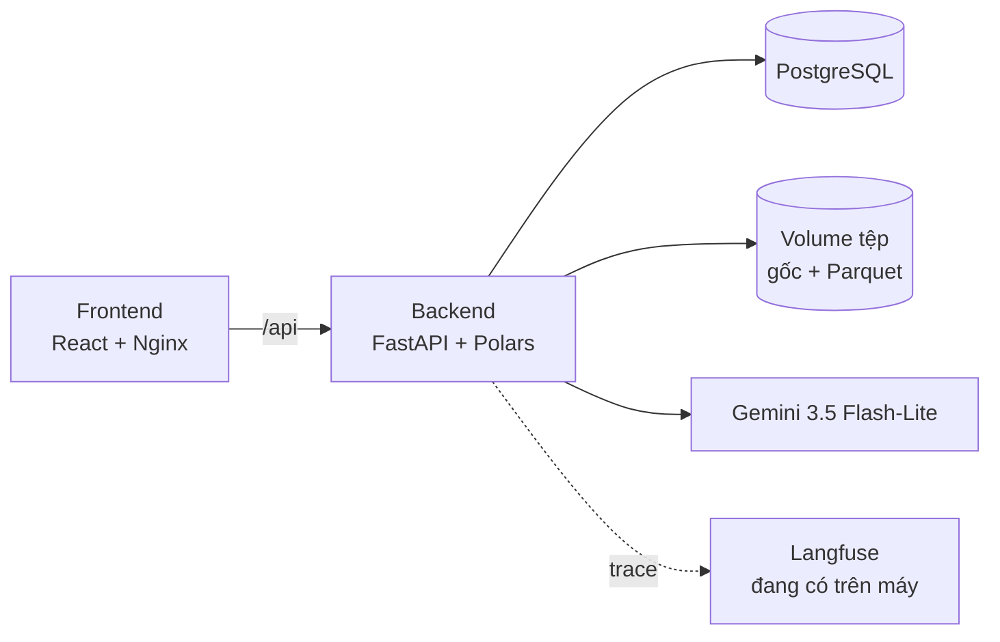
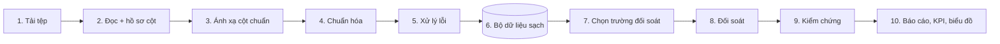

# Kiến trúc — AI Reconciliation Studio

Dự án **demo**: chỉ cần các chức năng chính chạy đúng và thể hiện đủ ý nghĩa. Mọi lựa chọn bên dưới đều có nguồn ở mục 10 ([R3](../RULES.md)) và giữ ở mức đơn giản nhất đủ dùng ([R5](../RULES.md)).

## 1. Mục tiêu

- **Người dùng:** tải dữ liệu lên → trò chuyện với AI Assistant → nhận kết quả. Người không biết nghiệp vụ cũng dùng được.
- **Hệ thống:** tự động hóa gần hết quy trình. Ca đơn giản thì tự xử lý; ca lỗi hoặc mơ hồ thì chỉ ra đúng dòng/ô, AI gợi ý cách xử lý, người dùng xác nhận.
- **Niềm tin vào kết quả:** mọi dòng được ghép đều có lý do, truy ngược được về dòng gốc, và được kiểm chứng tự động. Hệ thống không bao giờ tự bịa kết quả.

Miền demo đầu tiên: **bán hàng** (đơn hàng ↔ thanh toán ↔ sao kê ngân hàng). Engine viết chung để sau này thêm miền khác.

## 2. Nguyên tắc thiết kế

1. **AI gợi ý, code quyết định.** Mọi con số, mọi cặp ghép do code deterministic (chạy lại ra đúng kết quả cũ) tính. LLM chỉ làm ba việc: đoán nghĩa cột, hiểu câu chat, giải thích kết quả. Đây cũng là cách các hệ thống ERP lớn làm: quy tắc khớp chạy tự động, ca mơ hồ hoặc lệch thì để người kiểm tra ([Oracle Cash Management][oracle-rules]).
2. **Workflow trước, agent sau.** Quy trình xử lý là một chuỗi bước cố định trong code. Assistant chỉ chọn bước nào cần chạy và giải thích, không tự sáng tác quy trình. Anthropic khuyến nghị bắt đầu từ giải pháp đơn giản nhất và chỉ dùng agent tự quyết khi thật cần ([Building effective agents][anthropic-agents]).
3. **Phân tầng theo độ tin cậy.** Cao thì tự làm và ghi nhật ký. Trung bình thì gợi ý, người dùng xác nhận một lần cho cả nhóm. Thấp thì dừng lại, chỉ đúng ô và hỏi.
4. **Dữ liệu gốc bất biến** ([R15](../RULES.md)). Mỗi bước tạo một phiên bản mới; mọi kết quả trỏ về dòng gốc.

## 3. Thành phần

| Thành phần | Công nghệ | Vai trò |
| --- | --- | --- |
| Frontend | React + TypeScript + Vite, Nginx phục vụ | Giao diện; Nginx chuyển tiếp `/api` về backend cùng địa chỉ. Thiết kế bằng skill impeccable và ui-ux-pro-max |
| Backend | Python 3.12, FastAPI, Polars | API, chạy các bước xử lý dưới dạng tác vụ nền, gọi Gemini, ghi nhật ký |
| PostgreSQL | PostgreSQL | Thông tin bộ dữ liệu, ánh xạ, issue, kết quả đối soát, hội thoại |
| Volume tệp | Tệp gốc + Parquet | Tệp tải lên giữ nguyên; bảng đã đọc và bảng sạch lưu dạng Parquet (định dạng bảng cột, nén tốt, đọc nhanh) |
| Gemini | `gemini-3.5-flash-lite` qua SDK `google-genai` | Gợi ý ánh xạ, gợi ý xử lý lỗi, Assistant gọi công cụ, viết nhận xét báo cáo |
| Langfuse | Bộ Langfuse tự host **đã có sẵn trên Docker của máy** | Theo dõi từng câu chat: các bước gọi, độ trễ, token, lỗi |

**Docker: 3 container** (frontend, backend, postgres), cổng duy nhất là `127.0.0.1` cho frontend. Với demo khoảng 100.000 dòng, các bước xử lý chạy nền ngay trong backend kèm bảng trạng thái job; chưa cần container Worker riêng ([R5](../RULES.md)). Khi đo thấy nghẽn thì mới tách.

**Vì sao chọn Polars:** Polars đọc CSV và Excel (engine calamine viết bằng Rust, tài liệu Polars ghi là nhanh nhất trong các engine Excel), xử lý 100.000 dòng trong bộ nhớ thoải mái, ghi Parquet trực tiếp ([Polars read_excel][polars-excel]). Một thư viện thay được cho pandas + openpyxl + pyarrow.

## 4. Luồng dữ liệu

### 4.1 Đọc tệp và hồ sơ cột

- Đọc CSV và XLSX (chọn sheet, phát hiện dòng tiêu đề), **mục tiêu ≥ 100.000 dòng mỗi tệp**. Docs/PDF để sau.
- CSV nhận bảng mã UTF-8 (có/không BOM), UTF-16 có BOM (Excel "Unicode Text") và Windows-1258 (Excel "CSV" trên Windows tiếng Việt, ghi theo bảng mã ANSI của hệ thống); chữ đọc từ Windows-1258 được gộp dấu về dạng NFC ([Python codecs][py-codecs], [Unicode NFC][unicode-nfc]). Bảng mã khác (TCVN3/VNI) báo lỗi kèm cách lưu lại thành "CSV UTF-8".
- Tệp gốc lưu nguyên bản kèm mã SHA-256 (dấu vân tay để chứng minh tệp không bị đổi). Mỗi dòng có `row_ref` trỏ về số dòng trong tệp gốc.
- **Hồ sơ cột** (column profile): kiểu dữ liệu quan sát được, tỷ lệ trống, số giá trị khác nhau, vài giá trị mẫu, mẫu định dạng (giống mã, ngày, tiền, số điện thoại).

### 4.2 Ánh xạ về cột chuẩn

**Cột chuẩn** là bộ tên cột thống nhất của miền, ví dụ `order_id`, `amount`, `transaction_date`. Ánh xạ nghĩa là chỉ ra cột "Mã ĐH" trong tệp của người dùng chính là `order_id`.

Cách làm theo mô hình **lọc ứng viên → xếp hạng lại** của Magneto (VLDB 2025): bước rẻ tạo danh sách ứng viên, LLM chỉ xếp hạng lại ([Magneto][magneto]):

1. **Theo tên cột:** bỏ dấu, tách từ (`MaDonHang` → `ma don hang`), từ điển viết tắt Việt/Anh, đo độ giống bằng RapidFuzz ([RapidFuzz][rapidfuzz]).
2. **Theo giá trị:** khớp mẫu định dạng (mã, ngày, tiền, điện thoại), độ duy nhất.
3. **Gemini xếp hạng lại:** chỉ gửi tên cột, kiểu quan sát và tối đa 5 giá trị mẫu; Gemini trả JSON đúng schema định sẵn (structured output) ([Gemini structured output][gemini-structured]). Nghiên cứu của Parciak và cộng sự cho thấy LLM ánh xạ kém đi khi bị thiếu **hoặc thừa** ngữ cảnh, nên chỉ gửi vừa đủ ([Schema matching with LLMs][parciak]).

Điểm cao và không có ứng viên cạnh tranh thì tự áp dụng; còn lại vào danh sách xác nhận. Ánh xạ đã xác nhận được **ghi nhớ** theo cấu trúc tệp; lần sau tải tệp cùng cấu trúc thì tự áp dụng. Không có khóa Gemini thì hai lớp đầu vẫn chạy.

### 4.3 Chuẩn hóa

Mỗi cột chuẩn có một kiểu và một bộ chuyển đổi. Kết quả mỗi ô gồm giá trị chuẩn và trạng thái `VALID` (hợp lệ), `EMPTY` (trống) hoặc `INVALID` (không đọc được).

| Kiểu | Ví dụ đầu vào | Giá trị chuẩn |
| --- | --- | --- |
| Tiền | `1.000.000`, `1,000,000.00`, `(500)`, `1tr` | Số thập phân chính xác (Decimal, không làm tròn kiểu float) |
| Ngày | `05/11/2026`, `2026-11-05`, số ngày Excel | `2026-11-05`; thứ tự ngày/tháng suy từ **cả cột**, không đoán từng ô |
| Mã | `00123`, ` DH-01 ` | Chuỗi, giữ số 0 đầu, bỏ khoảng trắng thừa |
| Tên | `  Nguyễn  Văn A` | Chuẩn Unicode NFC, gọn khoảng trắng; thêm bản so khớp đã bỏ dấu và danh xưng |
| Điện thoại | `+84 912…`, `0912…` | Dạng `0912…` |

### 4.4 Xử lý lỗi (làm sạch)

Mỗi vấn đề là một **issue** gắn với dòng/ô, có mức độ và đề xuất. Phát hiện lỗi bằng **luật** rõ ràng; các hệ thống nghiên cứu như Raha/Baran dùng học máy bán giám sát ([Raha & Baran][raha-baran]) nhưng quá nặng cho demo, nên chỉ tham khảo cách phân loại lỗi.

| Mức | Ví dụ | Xử lý |
| --- | --- | --- |
| Tự sửa | Khoảng trắng, định dạng số/ngày, dòng trống, dòng trùng y hệt | Tự làm, ghi nhật ký sửa |
| Gợi ý | Gần trùng, giá trị bất thường, ngày đoán được | Gemini đề xuất cách sửa, người dùng xác nhận theo nhóm |
| Hỏi | Thiếu khóa, cùng mã khác số tiền, giá trị không đọc được | Chỉ đúng ô, chờ sửa hoặc loại dòng |

Nghiên cứu cho thấy LLM làm được việc phát hiện lỗi và điền giá trị thiếu ([Narayan và cộng sự, VLDB][narayan]), nhưng ở đây Gemini **chỉ đề xuất**, không tự ghi vào dữ liệu.

Kết quả: **bộ dữ liệu sạch**, là một phiên bản mới kèm nhật ký sửa, dùng cho đối soát.

## 5. Engine đối soát

Engine theo đúng các bước kinh điển của bài toán ghép bản ghi (record linkage): tiền xử lý → lọc ứng viên (blocking) → so sánh từng trường → phân loại → đánh giá ([Christen, Data Matching][christen]).

### 5.1 Chọn trường đối soát

Từ các cột chuẩn có ở cả hai bộ, engine chấm điểm theo: độ duy nhất, tỷ lệ có giá trị ở cả hai bên, tỷ lệ khớp thử trên mẫu. Kết quả là một **cấu hình đối soát**:

- khóa chính (ví dụ `order_id`), nếu có;
- cột số tiền và sai số cho phép;
- cột hỗ trợ: ngày (khung ±N ngày), tên, nội dung chuyển khoản.

Gemini diễn giải cấu hình bằng lời và gợi ý chỉnh; người dùng xác nhận.

**Tách mã từ nội dung chuyển khoản:** sao kê ngân hàng Việt Nam thường không có cột mã đơn; mã nằm trong nội dung (ví dụ `CK DH12345 NGUYEN VAN A`). Các dịch vụ trong nước như SePay, Casso cũng tách mã bằng mẫu regex từ nội dung ([SePay][sepay], [Casso][casso]). Engine dùng mẫu regex do người dùng xác nhận (Gemini có thể gợi ý mẫu từ vài dòng ví dụ).

### 5.2 Các vòng khớp

Chạy theo thứ tự từ chắc chắn tới kém chắc chắn; dòng đã ghép thì không tham gia vòng sau. Oracle cũng khuyến nghị chạy quy tắc 1:1 trước các loại khác ([Oracle matching rules][oracle-rules]).

1. **Khớp khóa chính xác 1:1:** cùng khóa, tiền trong sai số.
2. **Khớp theo điểm 1:1:** trong mỗi khối ứng viên (cùng khung ngày, tiền gần nhau), chấm điểm từng cặp từ nhiều trường (lệch tiền, cách ngày, độ giống tên bằng RapidFuzz). Cặp tốt nhất được chọn bằng thuật toán phân công tối ưu (assignment): `scipy.optimize.linear_sum_assignment`, thuật toán Jonker-Volgenant cải tiến ([SciPy][scipy-lsa]). Nó bảo đảm mỗi dòng chỉ dùng một lần và tổng điểm là cao nhất.
3. **Khớp nhóm 1:N, N:1:** trong cùng khối, tìm tổ hợp dòng có **tổng tiền khớp đúng**, giới hạn kích thước tổ hợp (mặc định ≤ 5 dòng) để không bùng nổ tổ hợp. Không áp sai số tiền cho khớp nhóm, như Oracle quy định ([Oracle tolerance][oracle-tolerance]). Tổng trùng có thể chỉ là ngẫu nhiên, nên đơn đã hủy không được ghép nhóm, dòng mang mã hay tên người khác bị loại khỏi nhóm, và nhóm không có mã hay tên ủng hộ cho mọi dòng thì chỉ đề xuất (nằm ở "Cần xử lý"), không tự xác nhận (phân tầng độ tin cậy, mục 2).
4. **Còn lại** thì phân loại.

Mỗi kết quả thuộc một loại:

| Loại | Ý nghĩa |
| --- | --- |
| `MATCHED` | Khớp hoàn toàn |
| `AMOUNT_MISMATCH` | Ghép được nhưng lệch tiền ngoài sai số |
| `ONLY_IN_A` / `ONLY_IN_B` | Chỉ có ở một bên (thiếu / thừa) |
| `ONE_TO_MANY` / `MANY_TO_ONE` | Ghép nhóm có tổng khớp |
| `AMBIGUOUS` | Nhiều ứng viên ngang điểm. Không tự chọn; trả về các ứng viên và lý do để người dùng chọn |
| `DUPLICATE` | Một bên có nhiều dòng giống hệt cùng trỏ một dòng bên kia |
| `PENDING_SETTLEMENT` | Chưa khớp nhưng còn trong khung chờ tiền về (chênh lệch do thời điểm, không phải lỗi); kỳ sau tự khớp lại |
| `NEEDS_CLEANING` | Dòng còn vấn đề mức "Hỏi" ở bước làm sạch; không ghép, chỉ ra để sửa rồi chạy lại |
| `OUT_OF_SCOPE` | Dòng không thuộc phạm vi bên kia (ví dụ đơn tiền mặt khi đối với cổng thanh toán, đơn đã hủy không có tiền về); suy từ dữ liệu, người dùng đổi được |

**Kỳ đối soát và khoản chuyển kỳ.** Tiền về muộn hơn ngày đơn (sàn trả sau vài ngày, cổng thanh toán chuyển theo đợt) là chênh lệch do thời điểm, không phải lỗi; kế toán gọi là khoản đang chuyển và mang sang kỳ sau ([Paychex][paychex], [Lumen Learning][lumen]). Mỗi lần đối soát có kỳ (tự suy từ khoảng ngày dữ liệu). Dòng chưa khớp còn trong khung chờ (mặc định T+3 ngày làm việc) được xếp `PENDING_SETTLEMENT`; lần sau tự đưa vào khớp lại, quá hạn mới thành `ONLY_IN_A/B`.

**Xử lý ngoại lệ.** Mỗi kết quả không khớp là một ngoại lệ có trạng thái `OPEN` → `EXPLAINED` / `RESOLVED`, lý do do engine sinh ra và ghi chú tùy chọn. Trạng thái tự đổi theo thao tác của người dùng. Đây là năng lực cốt lõi của phần mềm đối soát: ngoại lệ được chỉ ra, theo dõi tới khi xử lý xong ([iofm][iofm]).

**Ghép tay và gỡ ghép.** Người dùng ghép được một dòng "chỉ có ở một bên" với một hoặc vài dòng chưa ghép của bên kia (hệ thống xếp dòng gần số tiền, gần ngày nhất lên đầu), và gỡ được một cặp hệ thống đã ghép sai. Cả hai là lựa chọn được lưu (`recon_choices`, loại `MATCH` / `UNMATCH`): cặp ghép tay được áp dụng trước mọi vòng khớp; cặp đã gỡ thì không vòng tự động nào được ghép lại. Sau mỗi lựa chọn hệ thống chạy lại cặp (hoặc cả chuỗi) và kiểm chứng; mọi lần ghép, gỡ đều vào nhật ký kiểm toán. Đây là thao tác cơ bản của phần mềm đối soát ngân hàng (Oracle Cash Management: manual reconciliation, unreconcile).

Mỗi kết quả lưu **điểm và lý do** (trường nào khớp, lệch bao nhiêu). Gemini dùng lý do này để giải thích bằng lời vì sao thiếu, lệch hay thừa, nhưng không được tự đổi kết quả.

Đối soát luôn làm **hai bộ một lần** (A ↔ B). Ba bên của miền bán hàng chạy thành chuỗi: đơn hàng ↔ thanh toán, rồi thanh toán ↔ sao kê.

### 5.3 Kiểm chứng tự động

Sau mỗi lần chạy, một module **độc lập** (không gọi lại engine) kiểm:

- mỗi dòng của A và B nằm trong đúng một kết quả;
- tổng tiền từng bên được bảo toàn;
- số dòng theo từng loại cộng lại đúng tổng;
- mọi `row_ref` trỏ tới dòng có thật.

Kiểm chứng thất bại thì kết quả bị đánh dấu không dùng được cho báo cáo.

## 6. AI Assistant

Gemini có **gọi công cụ** (function calling): model không tự chạy hàm, mà trả về tên hàm và tham số để backend chạy ([Gemini function calling][gemini-fc]). Công cụ là chính các hàm mà giao diện dùng.

| Nhóm | Ví dụ | Quy tắc |
| --- | --- | --- |
| Đọc | `list_datasets`, `get_profile`, `get_mapping`, `list_issues`, `get_results`, `get_kpis` | Tự chạy |
| Xử lý | `suggest_mapping`, `prepare_dataset`, `run_reconciliation`, `build_report` | Tự chạy, báo lại đã làm gì |
| Thay đổi | `confirm_mapping`, `fix_cell`, `exclude_row`, `resolve_ambiguous` | Hiện **thẻ xác nhận** trong khung chat, người dùng bấm mới chạy |

**Bảo vệ** theo OWASP Top 10 cho ứng dụng LLM ([OWASP LLM 2025][owasp]):

- *Prompt injection* (chèn lệnh vào dữ liệu, LLM01): nội dung trong tệp chỉ là dữ liệu, được tách riêng khỏi câu lệnh của người dùng.
- *Excessive agency* (AI có quá nhiều quyền, LLM06): ít công cụ, tham số kiểm bằng schema, thao tác thay đổi phải xác nhận.
- Gemini chỉ nhận câu chat, tên cột, thống kê và vài giá trị mẫu; không nhận toàn bộ dữ liệu.
- Mỗi lần gọi có timeout, giới hạn token. Chỉ gọi khi người dùng thao tác, không gọi lúc khởi động ([R11](../RULES.md)).

**Hiện câu trả lời đang soạn bằng SSE** (Server-Sent Events, luồng một chiều từ máy chủ tới trình duyệt qua HTTP thường; FastAPI có sẵn `EventSourceResponse` ([FastAPI SSE][fastapi-sse]), Nginx không giữ lại dữ liệu nhờ header `X-Accel-Buffering: no` ([Nginx][nginx-buffering])). Lượt chat vẫn chạy nền, không phụ thuộc kết nối; `GET /api/assistant/messages/{id}/events` chỉ chuyển tiếp: `stage` (trạng thái đầy đủ của các bước, thẻ, nút dẫn trang sau mỗi lần ghi), `delta` (đoạn chữ mới; Gemini gọi bằng `generate_content_stream`), `complete` (tin nhắn đã lưu, rồi đóng luồng). Kết nối mới hay nối lại nhận ảnh chụp trước nên không mất, không lặp chữ. Mã kỹ thuật được đổi ngay trên từng đoạn: từ cuối và ngoặc chưa đóng được giữ lại tới khi đủ để đổi. Bộ phát sự kiện nằm trong bộ nhớ của tiến trình backend (chạy một tiến trình).

**Theo dõi bằng Langfuse:** mỗi câu chat là một *trace* (dấu vết), bên trong có các *span* (từng bước): lần gọi Gemini, từng công cụ, thời gian, token, lỗi. Langfuse SDK Python dựng trên OpenTelemetry ([Langfuse SDK][langfuse-sdk]); backend tự ghi mỗi lần gọi Gemini thành một *generation* (đầu vào đã che, đầu ra, token, lỗi) thay vì dùng gói tự ghi của bên thứ ba, để kiểm soát được nội dung gửi lên. Dùng bộ Langfuse **đã có trên máy**, nên dữ liệu trace không rời máy. Bên cạnh đó, bảng `ai_calls` lưu token và thời gian của mọi lần gọi kể cả khi Langfuse tắt; nội dung từng lần gọi (đầu vào đã che, câu trả lời) xem trên Langfuse.

**Nhật ký kiểm toán.** Mọi thay đổi của người dùng (xác nhận/đổi ánh xạ, sửa ô, giữ/loại dòng, đổi cách đọc ngày, xử lý ngoại lệ) được ghi tự động vào `audit_log`: ai, lúc nào, đối tượng, giá trị trước và sau. Phần mềm đối soát chuyên nghiệp đều ghi lại từng lần ghép, ngoại lệ, duyệt và điều chỉnh kèm thời điểm để phục vụ kiểm toán ([HighRadius][highradius]). Xem ở trang "Lịch sử".

## 7. Mô hình dữ liệu (PostgreSQL)

| Bảng | Nội dung |
| --- | --- |
| `workspaces` | Phiên làm việc: tên, lĩnh vực (hiện chỉ `SALES`). Bộ dữ liệu, chuỗi đối soát, cuộc trò chuyện, nhật ký kiểm toán và bộ nhớ ánh xạ có cột `workspace_id`; các bảng khác thuộc phiên qua bảng gốc **(đã có)** |
| `datasets`, `dataset_tables` | Tệp gốc (SHA-256), mỗi bảng đã đọc (một sheet), đường dẫn Parquet, hồ sơ cột, trạng thái đọc/ánh xạ/làm sạch **(đã có)** |
| `column_mappings`, `mapping_memory` | Ánh xạ từng cột kèm điểm, nguồn, trạng thái; ánh xạ đã xác nhận nhớ theo cấu trúc tệp **(đã có)** |
| `clean_versions` | Các phiên bản bộ dữ liệu sạch (Parquet), nhật ký sửa tự động và danh sách vấn đề **(đã có)** |
| `cell_corrections`, `row_decisions`, `ai_cell_suggestions` | Ô người dùng sửa, quyết định giữ/loại dòng, gợi ý sửa của AI **(đã có)** |
| `ai_calls` | Nhật ký mỗi lần gọi AI: mục đích, kết quả, mã lỗi (ví dụ `CLIENT_429`, `SERVER_503`), token, thời gian (không lưu nội dung) **(đã có)** |
| `recon_runs`, `match_results` | Kỳ, cấu hình, phiên bản bộ sạch đã dùng, trạng thái, kết quả kiểm chứng, các dòng chờ mang từ kỳ trước; từng kết quả kèm loại, điểm, lý do, các dòng, số tiền, trạng thái ngoại lệ, ghi chú **(đã có)** |
| `recon_chains`, `recon_choices` | Một lần đối soát cả chuỗi của một kỳ (các bảng, kỳ, trạng thái, nhận xét AI của báo cáo; các lần chạy trỏ về chuỗi); lựa chọn của người dùng (chọn ca mơ hồ, ghép tay: `MATCH`; gỡ ghép: `UNMATCH`), áp dụng ở mọi lần chạy sau **(đã có)** |
| `audit_log` | Nhật ký kiểm toán: mọi thay đổi của người dùng (ai, lúc nào, đối tượng, trước/sau) **(đã có)** |
| `chat_threads`, `chat_messages` | Hội thoại; mỗi câu trả lời của Assistant lưu các bước (công cụ, tham số, trạng thái), thẻ xác nhận và nút dẫn trang **(đã có)** |

Tác vụ nền chạy bằng FastAPI BackgroundTasks; trạng thái nằm ngay trên các bảng trên, chưa cần bảng `jobs` riêng ([R5](../RULES.md)).

Demo chỉ có **một người dùng**, không làm đăng nhập. Chỉ mở cổng trên `127.0.0.1`.

**Phiên làm việc.** Người dùng tách công việc thành nhiều phiên (mỗi cửa hàng, khách hàng hay đợt làm việc một phiên); phiên mới là trang trắng. Giao diện gửi mã phiên đang mở trong header `X-Workspace-Id` (luồng SSE, liên kết tải tệp: `?workspace=`); phụ thuộc `workspaces.use_workspace` gắn cho mọi router dữ liệu kiểm phiên có thật rồi đặt vào một ContextVar (giá trị riêng cho từng yêu cầu, PEP 567). Danh sách chỉ lấy của phiên, dữ liệu mới gắn vào phiên, đối tượng mở theo mã mà thuộc phiên khác trả 404. Tải trùng tệp chỉ tính trong một phiên; dòng chờ tiền về chỉ mang sang kỳ sau trong cùng phiên. Xóa phiên xóa mọi thứ bên trong (tệp gốc giữ lại nếu phiên khác cũng tải đúng tệp đó); luôn còn ít nhất một phiên. Không gửi mã phiên (công cụ dòng lệnh) thì dùng phiên tạo sớm nhất.

## 8. Báo cáo

Báo cáo lập theo **một kỳ** (lần đối soát chuỗi mới nhất của kỳ), kèm khối so sánh các kỳ. Module `reporting.py` chỉ **đọc** kết quả engine đã lưu (`recon_runs.summary`, `match_results`) và dòng gốc của đúng phiên bản sạch đã dùng; không chạy lại engine. Người đọc chính là chủ cửa hàng: phần đầu trả lời "tiền đã về đủ chưa, thiếu bao nhiêu, cần xử lý gì trước".

- **KPI:** tỷ lệ khớp theo số dòng và theo số tiền (phần khớp đúng hoặc ghép nhóm đúng tổng trên phần cần đối chiếu, tức bên A trừ dòng ngoài phạm vi; cả kỳ là bình quân có trọng số của các cặp), số ca cần xử lý, tổng lệch (tổng |A − B| của ca lệch tiền), thiếu tiền về (chỉ có ở A), tiền về chưa rõ nguồn (chỉ có ở B), chờ tiền về, 5 ngoại lệ lớn nhất.
- **Biểu đồ** (vẽ bằng HTML/CSS ở frontend theo skill dataviz, mỗi biểu đồ có bảng dữ liệu): theo ngày (cột chồng đã khớp / chờ tiền về / ngoại lệ), theo cặp đối soát, theo loại kết quả, tuổi ngoại lệ còn mở (0–3, 4–7, trên 7 ngày, tính tới **ngày cuối kỳ** để báo cáo một kỳ luôn cho cùng kết quả).
- **Xuất:** XLSX 3 sheet (Tóm tắt, Cần xử lý, Toàn bộ kết quả kèm lý do và dòng gốc) và CSV (Toàn bộ kết quả, UTF-8 có BOM); hai định dạng dựng từ cùng một bảng. Ô chữ bắt đầu bằng `= + - @` được thêm dấu `'` để Excel không chạy như công thức (CSV Injection, [OWASP][owasp-csv]). PDF để sau nếu cần.
- **Kiểm chứng:** kỳ chưa đạt kiểm chứng vẫn xem được kèm cảnh báo nhưng không xuất tệp, không viết nhận xét AI (mục 5.3).
- **Nhận xét AI:** chỉ khi người dùng bấm. Gemini chỉ nhận các con số đã định dạng sẵn; code kiểm mọi con số trong lời nhận xét phải có nguyên văn trong số liệu đó, có số lạ thì bỏ cả lời nhận xét. Lời nhận xét lưu kèm dấu vân tay số liệu; số liệu đổi (chạy lại, xử lý ngoại lệ) thì báo đã cũ.

## 8b. Bản đồ mã nguồn

Mỗi bước của luồng dữ liệu (mục 4) nằm ở đúng một nhóm file; backend ở `backend/studio/`, giao diện ở `frontend/src/`, kiểm thử ở `tests/`.

| Bước | Backend: xử lý | Backend: API | Giao diện | Kiểm thử |
| --- | --- | --- | --- | --- |
| 1–2. Tải và đọc tệp, hồ sơ cột | `storage.py` (tệp gốc, SHA-256), `reading.py` (CSV/XLSX, dòng tiêu đề, `row_ref`), `profiling.py`, `ingestion.py` (tác vụ nền) | `datasets_api.py` | `pages/DataPage`, `DatasetPage`, `UploadZone`, `TablePreview`, `ColumnProfileView` | `test_reading`, `test_datasets_api`, `test_profiling`, `test_upload_race` |
| 3. Ánh xạ cột chuẩn | `sales_fields.py` (17 cột chuẩn), `mapping_rules.py` (quy tắc), `masking.py` (che dữ liệu), `mapping_service.py` (gộp với Gemini, loại bảng, bộ nhớ) | `mapping_api.py` | `MappingView` | `test_mapping` |
| 4–6. Chuẩn hóa, làm sạch | `value_parsers.py` (tiền, ngày, mã, tên, điện thoại), `cleaning.py` (dựng bộ sạch, phát hiện vấn đề), `cleaning_ai.py` (Gemini gợi ý sửa ô), `table_locks.py` | `cleaning_api.py` | `CleaningView`, `CleanPreview` | `test_cleaning` |
| 7–8. Chọn trường, đối soát | `reconciliation.py` (engine thuần: chọn trường, phạm vi, ca mơ hồ, chờ tiền về), `matching_rounds/` (mỗi vòng khớp một tệp: `key_match`, `score_match`, `group_match`; bật, tắt, thứ tự trong `config/rules/reconciliation.json`) | `recon_api.py` | `pages/ReconcilePage`, `ReconRunView`, `ChainView` | `test_reconciliation`, `test_phase5`, `test_recon_review_fixes` |
| Kỳ, chuỗi ba bên, lưu kết quả | `recon_service.py` (kỳ, cặp nối được, hai lượt của chuỗi, dòng chờ kỳ trước, lựa chọn của người dùng) | `recon_api.py` | `ChainView` | `test_phase5` |
| 9. Kiểm chứng | `recon_verification.py` (độc lập với engine) | `recon_api.py` (`/verify`) | `VerificationSeal` | `test_reconciliation`, `test_phase5` |
| AI giải thích | `gemini_client.py` (timeout, thử lại, bảng `ai_calls`), `tracing.py` (Langfuse), `recon_ai.py` | (trong các API trên) | nút "Giải thích" | `test_mapping`, `test_recon_review_fixes` |
| AI Assistant | `assistant.py` (vòng gọi công cụ, tối đa 8 bước, chữ đang viết), `assistant_events.py` (bộ phát sự kiện SSE), `assistant_tools.py` (25 công cụ: 10 đọc gồm `get_report`, 4 xử lý, 11 thay đổi qua thẻ xác nhận), `gemini_client.generate_with_tools` | `assistant_api.py` | `pages/AssistantPage`, `ChatMessageView` | `test_assistant`, `test_assistant_stream`; đo Gemini thật: `tools/evaluate_assistant.py` |
| Nhật ký kiểm toán | `audit.py` | `recon_api.py` (`/audit`) | `pages/HistoryPage` | các bài có kiểm `audit_log` |
| 10. Báo cáo, KPI, xuất tệp | `reporting.py` (số liệu từ kết quả đã lưu), `report_export.py` (XLSX/CSV), `report_ai.py` (nhận xét AI có kiểm số) | `report_api.py` (`/api/reports`) | `pages/ReportsPage`, `ReportCharts`, khối số chính trên `OverviewPage` | `test_reports` |
| Cấu hình nghiệp vụ | `config/` ở gốc dự án (cột chuẩn, loại bảng, từ điển, ngưỡng, vòng khớp, prompt, khuôn JSON; xem `config/README.md`), `config_files.py` (đọc và kiểm bằng pydantic, kiểm hết lúc khởi động) | — | — | `test_config_files` |
| Phiên làm việc | `workspaces.py` (phiên của mỗi yêu cầu, kiểm đối tượng thuộc phiên) | `workspaces_api.py` (`/api/workspaces`) | `workspace.ts`, `WorkspaceContext.tsx`, `WorkspaceSwitcher`, `pages/WorkspacesPage` | `test_workspaces`; E2E `workspaces` |
| Khung | `main.py`, `config.py`, `database.py`, `models.py`, `migrate.py` + `migrations/` | `/api/health`, `/api/ready`, `/api/status` | `App.tsx`, `navigation.ts`, `OverviewPage` | `test_status_api`, `test_migrations` |

Kiểm hồi quy cho các lỗi tìm thấy khi rà toàn bộ nền: `test_foundation_review.py`. Ghép tay, gỡ ghép: `recon_api.py` (`/match`, `/unmatch`, `/match-candidates`), `MatchPicker`, `test_manual_match.py`. Kiểm mù đối soát: `tools/make_blind_fixtures.py` → `tests/fixtures/blind/`, đo ở `test_blind.py`. Đo tốc độ trọn luồng ở quy mô lớn: `tools/measure_scale.py` (cơ sở dữ liệu tạm, không gọi Gemini). E2E: `frontend/e2e/` (`data`, `recon`, `chain`, `assistant`, `shell`).

## 9. Ngoài phạm vi demo

Đọc Docs/PDF, nhiều người dùng và phân quyền, xuất PDF, đối soát N:N, các miền kế toán/công nợ/bảng lương. Engine được viết chung để có thể thêm sau.

## 10. Nguồn tham khảo

| Chủ đề | Nguồn |
| --- | --- |
| Quy trình ghép bản ghi | P. Christen, *Data Matching*, Springer 2012 ([link][christen]) |
| Mô hình xác suất ghép bản ghi | Fellegi & Sunter 1969; triển khai mã nguồn mở Splink ([link][splink]). Chỉ tham khảo; demo dùng điểm có quy tắc rõ ràng |
| Phân công tối ưu | Crouse 2016, IEEE TAES; `scipy.optimize.linear_sum_assignment` ([link][scipy-lsa]) |
| Quy tắc đối soát ngân hàng | Oracle Fusion Cash Management: matching rules, tolerance ([link][oracle-rules], [link][oracle-tolerance]) |
| Khoản chuyển kỳ, xử lý ngoại lệ, nhật ký kiểm toán | Paychex ([link][paychex]), Lumen Learning ([link][lumen]), iofm ([link][iofm]), HighRadius ([link][highradius]) |
| Ánh xạ cột bằng LLM | Magneto, PVLDB 18 (2025) ([link][magneto]); Parciak và cộng sự, TaDA@VLDB 2024 ([link][parciak]) |
| LLM cho làm sạch dữ liệu | Narayan và cộng sự, PVLDB 16 ([link][narayan]); Raha & Baran, CIDR 2021 ([link][raha-baran]) |
| Tách mã từ nội dung chuyển khoản | Tài liệu SePay ([link][sepay]), Casso ([link][casso]) |
| Thiết kế agent | Anthropic, *Building effective agents* ([link][anthropic-agents]) |
| Bảo mật LLM | OWASP Top 10 for LLM Applications 2025 ([link][owasp]) |
| Công nghệ | Polars ([link][polars-excel]), RapidFuzz ([link][rapidfuzz]), Gemini ([link][gemini-model], [link][gemini-fc], [link][gemini-structured]), Langfuse ([link][langfuse-sdk], [link][langfuse-gemini]) |

[christen]: https://users.cecs.anu.edu.au/~Peter.Christen/data-matching-book-2012.html
[splink]: https://moj-analytical-services.github.io/splink/
[scipy-lsa]: https://docs.scipy.org/doc/scipy/reference/generated/scipy.optimize.linear_sum_assignment.html
[oracle-rules]: https://docs.oracle.com/en/cloud/saas/financials/24d/faipp/reconciliation-matching-rules.html
[oracle-tolerance]: https://docs.oracle.com/en/cloud/saas/financials/25d/fairp/overview-of-tolerance-rules.html
[magneto]: https://arxiv.org/abs/2412.08194
[parciak]: https://arxiv.org/abs/2407.11852
[narayan]: https://www.vldb.org/pvldb/vol16/p738-narayan.pdf
[raha-baran]: https://www.vldb.org/cidrdb/papers/2021/cidr2021_paper14.pdf
[sepay]: https://developer.sepay.vn/en/sepay-webhooks/doi-soat-giao-dich
[casso]: https://developer.casso.vn/v1/thuc-hanh/tich-hop-xac-nhan-thanh-toan
[anthropic-agents]: https://www.anthropic.com/engineering/building-effective-agents
[owasp]: https://genai.owasp.org/llm-top-10/
[polars-excel]: https://docs.pola.rs/api/python/stable/reference/api/polars.read_excel.html
[rapidfuzz]: https://rapidfuzz.github.io/RapidFuzz/Usage/fuzz.html
[gemini-model]: https://ai.google.dev/gemini-api/docs/models/gemini-3.5-flash-lite
[gemini-fc]: https://ai.google.dev/gemini-api/docs/function-calling
[gemini-structured]: https://ai.google.dev/gemini-api/docs/structured-output
[fastapi-sse]: https://fastapi.tiangolo.com/tutorial/server-sent-events/
[nginx-buffering]: https://nginx.org/en/docs/http/ngx_http_proxy_module.html#proxy_buffering
[langfuse-sdk]: https://langfuse.com/docs/observability/sdk/python/setup
[langfuse-gemini]: https://langfuse.com/integrations/model-providers/google-gemini
[paychex]: https://www.paychex.com/articles/finance/what-is-a-bank-reconciliation
[lumen]: https://courses.lumenlearning.com/suny-ecc-finaccounting/chapter/preparing-a-bank-reconciliation/
[iofm]: https://www.iofm.com/ap/organizational-structure/choosing-the-right-automated-bank-account-reconciliation-software-a-guide-for-treasury-and-finance-leaders
[highradius]: https://www.highradius.com/product/automated-account-reconciliation-software/
[owasp-csv]: https://owasp.org/www-community/attacks/CSV_Injection
[py-codecs]: https://docs.python.org/3/library/codecs.html#standard-encodings
[unicode-nfc]: https://unicode.org/reports/tr15/
[sqlalchemy-bulk]: https://docs.sqlalchemy.org/en/20/orm/queryguide/dml.html#orm-bulk-insert-statements
