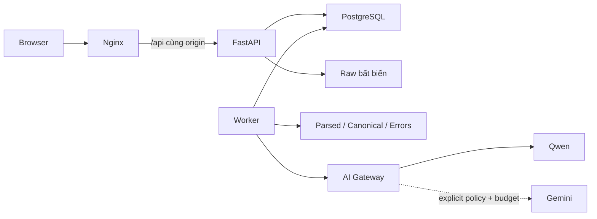

# Kiến trúc ứng dụng

Data Foundation và Reconciliation đã nghiệm thu theo [kế hoạch](PROJECT_PLAN.md). Assistant candidate trên feature branch tiêu thụ các contracts hiện có; không viết lại engine hay verifier. Bằng chứng, giới hạn và trạng thái chưa merge main tại [báo cáo triển khai](IMPLEMENTATION_STATUS.md).

## Contextual Assistant

Theo yêu cầu Product UX ngày 30/10/2026, Assistant là trang trong AppShell, thay panel tại kế hoạch §28; không thêm router hoặc implementation chat thứ hai. History API lưu identifiers trong URL, API xác minh quyền khi khôi phục; bản nháp theo actor/scope nằm trong sessionStorage của tab. Reconciliation giữ state khi đi sang Assistant và trở về, không dựng lại engine hoặc tính KPI ở frontend.

`assistant_tools.py` chỉ đọc theo actor/workspace/project/explicit run; `assistant.py` kiểm và render claims từ `AnswerFactSet`. `assistant_api.py` dùng auth/session/Origin hiện có. Hai bảng additive `conversations`/`conversation_messages` lưu context cố định theo hội thoại, messages, facts và citations; mỗi actor chỉ xem hội thoại của mình. Đổi run/group tạo hội thoại mới. Pagination dùng `(created_at,id)` và scoped cursor.

Messages vào queue PostgreSQL hiện có, không có queue/service mới. `assistant_jobs.py` dùng lease/fencing, membership và tombstone kiểm lại trước atomic publish; unique `(job_id,role)` và response ID xác định ngăn nhân đôi. Reclaimed job đã có provider reservation bị giữ `AI_DELIVERY_UNKNOWN`, không resend. Durable task ceiling bổ sung, không thay global/workspace Gemini budgets. Trace lưu actual usage khi có receipt, thiếu token/cost để null; failure chỉ ghi reservation đã biết, không bịa receipt.

Xóa hội thoại yêu cầu đúng actor và CSRF/Origin: xóa nội dung messages, giữ tombstone và audit; job payload không chứa câu hỏi/raw facts. Không tự xóa runs/rules/artifacts. Demo giữ hội thoại đến khi chủ hội thoại xóa; chưa có thời hạn retention tự động. Cache chỉ tái dùng deterministic answer đã verified khi câu hỏi/context/FactSet hash khớp, không cache proposal mơ hồ thành quyết định đã duyệt.

Workflow ngôn ngữ là đề xuất review, không là tool ghi. UI chọn hai hoặc ba nguồn READY, mẫu đã duyệt, kỳ/coverage và snapshot time cụ thể; ba nguồn tạo hai cặp theo rule, không JOIN ba nguồn. API reuse cũ kiểm signatures/semantics/effective dates và idempotency, trả PROPOSED. Người dùng mở kế hoạch, kiểm tra lại điều kiện, lưu và duyệt qua workflow Đối soát hiện có rồi mới chạy. Danh sách bản nháp có phân trang lấy từ PlanRow hiện có, chỉ của actor/project; không thêm workflow store. Shortlist trong câu trả lời không thay danh sách đầy đủ các mẫu đã duyệt hay kiểm quyền backend.

Migration `create_conversations` không đổi migrations cũ/runs/artifacts; downgrade từ chối bỏ hội thoại đã lưu. Rollback image main dùng override đã kiểm compatibility, bỏ riêng bước Alembic startup cũ vốn không biết revision mới; không downgrade DB. Backup drill dùng transaction snapshot, metadata phản chiếu schema hiện tại và published-file checksums; restore vào schema UUID trong PostgreSQL hiện có, đối chiếu toàn bộ metadata/hội thoại/quotas và từng file. Xem lệnh vận hành, copy backup ra host và giới hạn production tại [README](../README.md).

## Thành phần đang chạy

Một Compose project `ai-reconciliation-studio`, gồm `frontend`, `backend`, `worker`, `postgres`. Backend/worker dùng chung image và code. PostgreSQL giữ quan hệ, metadata, session, policy, jobs, attempts, approvals và audit. Volume `artifacts` giữ raw và Parquet. Không dùng database riêng cho từng upload; không dựng Redis, broker, model server hoặc container test.

## Ranh giới module

Document route dùng cùng upload/storage/jobs: JSON artifact bất biến có FileArtifact nguồn và page/items/bbox/usage; không tạo table/canonical tài chính tự động. Account preflight là GET read-only; reservation toàn hệ thống/workspace commit trước POST, giới hạn hai tài liệu SHA256 đã cho phép, một PDF/một DOCX, cost_effective/max_pages=2. Remote job ID được lưu trước polling; nếu đã nhận thì resume GET, nếu mất receipt thì block resubmission. Sau nghiệm thu live, quyền tạo job bị thu hồi, cached artifact vẫn đọc qua API có authorization/checksum. Gemini là provider mặc định theo quyết định chủ dự án; cài mới vẫn cloud OFF/0 budget. Không chạy lại Qwen đang hoãn.

| Module | Trách nhiệm |
|---|---|
| `contracts` | Pydantic domain objects và REST response schemas |
| `parsing` | F01–F04: inspection, route, đọc và kiểm tra cấu trúc |
| `profiling` | F05–F06: thống kê xác định, chữ ký và shortlist |
| `ai_gateway`, `document_parser` | Provider adapters, policy và kiểm tra output |
| `schema_mapping` | F08/F10: constraints, kiểu và quy tắc được duyệt |
| `normalization` | F11–F12: DSL, Decimal, lỗi, lineage và chất lượng |
| `repository`, `database` | Scoped records, idempotency và quan hệ PostgreSQL |
| `access` | Session, membership, CSRF/Host và xác minh triển khai local |
| `api` | REST, authorization và DTO; không gửi storage path ra frontend |
| `worker` | Claim, lease, attempts, retry và xuất bản nguyên tử |

## Publication và khôi phục

Upload đọc theo block, kiểm tra hash và ghi raw bằng exclusive create. Job parse tạo Parquet mới trước; refs và metadata chỉ được công bố trong transaction khi claim token và lease còn hợp lệ. Normalization cũng ghi artifact canonical/errors trước rồi kiểm tra lại active mapping, giữ khóa bảng và công bố cùng transaction.

Các tệp chưa được tham chiếu sau crash/rollback có thể tồn tại; không có tác vụ xóa tự động. Chúng không xuất hiện qua API. Không sửa artifact cũ. Unique constraints và advisory lock ngăn enqueue/upload trùng; `FOR UPDATE SKIP LOCKED` tránh claim trùng. Lease mặc định 300 giây, tối đa ba job attempts; mỗi lời gọi Qwen/Gemini tối đa hai HTTP attempts bên trong một job. Provider lỗi giữ job `BLOCKED`, không tự chuyển cloud hoặc tự lặp provider liên tục. Gemini chỉ chạy khi được chọn explicit và có quyền/key/budget; mỗi attempt có audit reservation commit trước HTTP dưới global advisory lock. Trần global/workspace không reset qua restart. Không cần migration mới vì dùng bảng audit hiện có.

Worker chạy một job tại một thời điểm, Polars giới hạn hai threads, memory limits: backend 384 MiB, worker 512 MiB, PostgreSQL 256 MiB, Nginx 128 MiB. Đây là cấu hình hạn chế tài nguyên được kiểm tra trên máy 16 GB RAM; không phải benchmark sức tải. Vượt giới hạn trả lỗi/cần review, không cắt mất dòng.

## Truy cập local

Host chỉ publish `127.0.0.1:18180`; backend/PostgreSQL không có host port. `tools/verify-local.ps1` lấy Docker inspection thực trên host và gửi metadata không chứa env vào backend qua `docker compose exec`. Backend kiểm tra đủ bốn service, đúng project và mọi published port là loopback trước khi tạo proof trong tmpfs. Không mount Docker socket.

Proof gắn với nonce của lần backend khởi động và ID frontend. Mỗi lần xác thực demo kiểm tra thêm identity frontend qua `/health` nội bộ. Recreate backend hoặc frontend làm proof cũ mất hiệu lực. Xác minh cấu hình bị từ chối cũng xóa proof cũ. Chạy `tools/start.ps1` hoặc `tools/verify-local.ps1` sau restart/recreate trước khi mở lại Dashboard.

Session ngẫu nhiên được lưu dưới dạng HMAC-SHA256 trong DB, cookie HttpOnly/SameSite Strict/TTL 8 giờ. Không có token trong URL hay bundle. Mọi API dữ liệu kiểm tra membership workspace; viewer không được ghi/approve. Write cần Origin nằm trong allowlist, Host được kiểm tra và forwarded/public proxy headers bị từ chối. Ngoài demo, có fallback Bearer token dành cho operator, cấu hình ở backend; không có auto-session ngoài local. Không hỗ trợ publish Internet hoặc proxy công cộng trong phạm vi đã kiểm tra.

## Phương pháp và giới hạn

| Phương pháp | Input → output | Điều kiện, giới hạn và kiểm tra |
|---|---|---|
| Candidate schema matching [D] | tên/kiểu/mẫu → tối đa 5 target hợp lệ mỗi cột | Alias có kiểm soát; O(cột nguồn × cột đích); không phải confidence xác suất. Không auto-approve; Total mơ hồ phải review. T08/T10/T37 |
| Header detection [D] | tối đa 30 dòng đầu → vị trí header và warning | Dòng đầu có ít nhất hai nhãn khác nhau; workbook/phần ghi chú phức tạp cần người dùng chọn header. Không tự chia nhiều vùng bảng trong cùng sheet. T04/T06 |
| Profiling [D] | parsed strings → count/type candidates/sample | O(dòng × cột); null, empty và distinct tách riêng. Min/max hiện là lexical, không đại diện thống kê tiền. Mẫu tối đa 5/cột, AI nhận tối đa 3 mẫu đã đổi thành dạng ký tự. T07 |
| Decimal normalization | chuỗi + locale đã duyệt → Decimal/null/error | Không float, không exponent, không làm tròn; Decimal tối đa 38 digits/18 fractional digits. T15/T16 và property tests |
| Approved aggregation [D] | keys/metric/currency/unit/grain + rule → nhóm có đủ thành viên nguồn | Không nhóm null/invalid/mixed values. Không giữ một dòng đại diện thay toàn bộ lineage. Kiểm tra tổng số/uniqueness source members và signed sum bằng fixture tính tay |

Taxonomy mapping tham chiếu [Rahm–Bernstein](https://www.microsoft.com/en-us/research/publication/on-matching-schemas-automatically/); không nhận thuật toán alias của dự án là mô hình đã được hiệu chỉnh. Parser đối chiếu [Polars Excel](https://docs.pola.rs/user-guide/io/excel/), phép tính đối chiếu [Python Decimal](https://docs.python.org/3/library/decimal.html), queue đối chiếu [PostgreSQL SKIP LOCKED](https://www.postgresql.org/docs/current/sql-select.html), inspection theo [OWASP File Upload](https://cheatsheetseries.owasp.org/cheatsheets/File_Upload_Cheat_Sheet.html). Các nguồn này được mở kiểm tra ngày 28/10/2026; không tạo ra tuyên bố accuracy/benchmark.

## Reconciliation và kết quả

Phân loại project tái sử dụng AuditRow hiện có, append-only và chỉ owner thay đổi qua API scoped có khóa/conflict guard. ProjectRow/raw/mapping/run không đổi; UNKNOWN cho legacy/no event, không phân loại tự động trong request/runtime. Một lần rà inventory fixture có bằng chứng được thực hiện qua API, ghi từng ID trong báo cáo. Selector hiện có thêm một toggle và phần quản lý current project thu gọn; ẩn là preference hiển thị, không security boundary. Recent Data có một bounded GET5 nguồn mới nhất riêng, không chia sẻ mảng phân trang25 nguồn với Data Explorer, không framework/cache thứ hai.

Quality hardening Giai đoạn 1–2: App giữ session/project/dataset state và orchestration; ProjectSelector quản lý search một trang20 items, abort/focus, không lưu toàn bộ projects. Saved project đọc theo ID scoped. DataOverview chỉ trình bày summary/next action từ backend; DatasetList dùng chung ở components, không có financial calculation. `preparation_overview` trong repository chỉ đọc counts/target IDs theo project, không approve/execute. Summary giữ fields cũ và thêm quality breakdown/typed navigation, không migration.

ReconciliationStudio giữ rule draft và run state khi đổi các trang kết quả trong cùng project; ReconciliationEvidence giữ cell preview/review form cho đúng run/group, dùng lại evidence/review APIs. Run generation/sequence guards chặn response bằng chứng/export cũ; job polling có abort khi unmount. Project refresh chỉ poll khi còn active jobs, không chạy đồng thời nhiều refresh, còn refresh thủ công. Quyền UI lấy role từ session; backend tiếp tục là nơi quyết định authorization. Chưa thay auth model, engine/verifier hoặc provider.

`reconciliation_contracts` kiểm tra canonical refs, scope/revision, schema/grain, keys/types, metric/basis/currency/unit, thời gian/coverage/effectiveness và evidence. `domain_templates` dùng lại SchemaDefinition; không coi Order là Settlement/Payout. Tiền/currency chưa xác nhận không trở thành approved vì dùng template.

`reconciliation_repository` đọc Parquet với SQL cố định/parameters qua DuckDB in-memory, checksum trước đọc; không nhận SQL hoặc storage path từ client. DuckDB 2.0.0, RapidFuzz 3.14.6 và ECharts 6.1.0 đã pin và kiểm tra tương thích. `pytz` 2026.5 cần cho chuyển TIMESTAMP WITH TIME ZONE sang Python trong Linux DuckDB. Không tạo database DuckDB bền vững hoặc engine metadata thứ hai.

`reconciliation_engine` partition → composite keys → duplicate review → approved 1:N/N:1 signed sums → bounded blocking/fuzzy candidates → comparison/exceptions. Keys là giá trị canonical qua transformation được duyệt từ Giai đoạn 1, không tự trim/fuzzy ID. Không JOIN ba nguồn: Internal chia platform/shop trước từng pair. Không dùng tiền để chọn liên kết. Mỗi member có toàn bộ provenance; similarity 0–100 chỉ là Indel score, không xác suất/auto-approve.

`verification` không import matcher: dựng lại scope từ ngày local và sources, membership/cardinality, source signed sums theo metric/currency, comparisons/tolerance, provenance và deterministic group IDs. Metrics chỉ được tạo sau kiểm tra độc lập. Worker ghi draft Parquet trước, khóa TableRow theo thứ tự và kiểm tra active mapping/stale lần nữa, fence lease trước transaction công bố result ref/checks/snapshot/cases. Unique project/input_signature và queue idempotency ngăn hai logical results. Fail giữ checks/draft, không metrics/export. Case review không sửa result/snapshot.

`reconciliation_jobs` mở rộng đúng queue hiện có. AI Planner dùng GeminiProvider transport chung và prompt/schema riêng, bounded metadata/masked samples. Audit reserve global/workspace giữ nguyên, thêm task ceiling tối đa 2 attempts cho nhiệm vụ này; không reset quota, không probe Qwen/fallback. Reclaimed AI job có receipt không tự gửi lại khi delivery chưa rõ. Manual rule builder luôn có sẵn.

Migration `create_reconciliation` chỉ thêm plans/contracts/runs/cases/exports và indexes; không sửa migration cũ hoặc canonical IDs. PostgreSQL giữ metadata; match details Parquet, exports filesystem có checksum. Downgrade phá dữ liệu bị chặn. Trước migration đã tạo archive metadata trên volume PostgreSQL hiện có và kiểm tra danh mục archive; đây chưa phải disaster restore drill.

`ReconciliationStudio` dùng App Shell hiện có, lazy-load ECharts, API pagination/search/filters, bốn KPI và chart từ backend snapshot/counts. Số case mở hiện tại do API đếm, tách số frozen tại run; lúc chờ hiển thị loading, không 0 giả. Export backend dùng cùng snapshot, typed Decimal/ID và text injection guard. CSV/XLSX không có công thức tính lại KPI.

Kiểm toán bổ sung: Planner nhận PlanningRequest riêng, context gate không buộc complete matching rule; output suggestions hoặc complete plan vẫn được kiểm nghĩa, approval và execution giữ gate cũ. Readiness reuse record_partition của engine; verifier giữ implementation độc lập. Group evidence bổ sung field EvidenceRefs từ đúng historical mapping/provenance, tiếp tục dùng API đọc nguồn cũ. Report-2 ghi thời điểm/phạm vi review, cached immutable theo run/format/revision, đọc review trong REPEATABLE READ; report-1/snapshots/raw/canonical không bị sửa. UI bỏ period/timezone mặc định, cần xác nhận scope; builder thủ công ở phần mở rộng. Không thêm service, migration, dependency hoặc môi trường.

Nguồn đã kiểm tra ngày 28/10/2026: [DuckDB Python/Parquet](https://duckdb.org/docs/2.0/clients/python/overview), [RapidFuzz ratio](https://rapidfuzz.github.io/RapidFuzz/Usage/fuzz.html), [Decimal Python 3.12](https://docs.python.org/3.12/library/decimal.html), [ECharts selective imports](https://echarts.apache.org/handbook/en/basics/import/). Core exact/group O(n log n); fuzzy tối đa 20.000 pairs, 200 counterpart/block, text 512 ký tự và top-k trái tối đa 5. Vượt cap báo lỗi, không cắt source rows hoặc giả kết quả đầy đủ. Hỗ trợ tối đa 100.000 tổng canonical records/run; benchmark đã đo tới 50.000 tổng, không phải cam kết sức tải HTTP/export cùng quy mô.
