# Hướng dẫn sử dụng và tự kiểm thử AI Reconciliation Studio

Tài liệu dành cho người mới, dùng ứng dụng local tại <http://127.0.0.1:18180>. Chỉ dùng dữ liệu tổng hợp trong bài thực hành. Giữ riêng dự án thử nghiệm với dữ liệu đang sử dụng thật.

## 1. Hiểu giao diện trước khi bắt đầu

Ảnh minh họa vùng hội thoại từ một dự án dữ liệu tổng hợp.

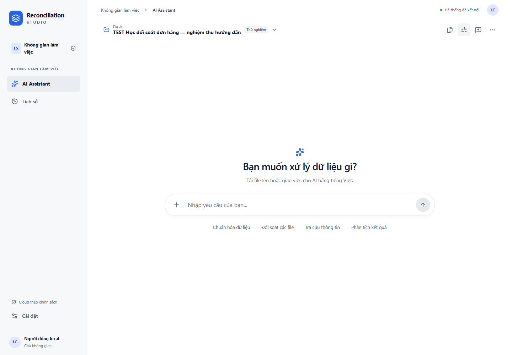

| Khu vực hoặc nút | Ở đâu | Dùng làm gì, khi nào dùng |
| --- | --- | --- |
| AI Assistant | Thanh bên trái | Trở về hội thoại để tải tệp, giao việc, xem câu trả lời và xác nhận |
| Dữ liệu | Thanh bên trái | Tải CSV/XLSX, chọn tệp và sheet, xem giá trị gốc, bản tự chuẩn bị hoặc dòng cần kiểm tra |
| Đối soát | Thanh bên trái | Chọn nguồn chuẩn hóa, kiểm phạm vi và duyệt quy tắc |
| Báo cáo | Thanh bên trái | Xem kết quả đã xác minh, biểu đồ, bằng chứng và tải CSV/XLSX |
| Lịch sử | Thanh bên trái | Tìm và mở lại hội thoại đã lưu; trên điện thoại mở nút điều hướng trước |
| Cài đặt | Thanh bên trái | Xem tài khoản, quyền sử dụng, chia sẻ dữ liệu và giới hạn tệp |
| Dự án | Đầu vùng Chat, cạnh biểu tượng thư mục | Chọn nhóm dữ liệu đang làm việc. Tên như “Dữ liệu mới” là tên dự án, không phải tên tệp |
| Tệp đã tải | Biểu tượng tệp trên thanh công cụ Chat | Mở danh sách tệp, chọn sheet, xem dữ liệu gốc, bản chuẩn hóa hoặc dòng lỗi |
| Đổi ngữ cảnh phân tích | Biểu tượng thanh trượt cạnh nút tệp | Chọn kết quả đối soát để các câu hỏi tiếp theo dùng đúng kết quả |
| Hội thoại mới | Biểu tượng hội thoại có dấu cộng | Bắt đầu yêu cầu riêng; không xóa tệp và kết quả cũ |
| Tùy chọn hội thoại | Dấu ba chấm trên thanh công cụ Chat | Mở thiết lập thủ công, thông tin chế độ hoặc xóa hội thoại khi chủ động cần |
| Dấu cộng | Bên trái ô nhập ở cuối Chat | Đính kèm CSV hoặc XLSX; có thể chọn nhiều tệp |
| Ô nhập | Cuối vùng Chat | Nhập yêu cầu. Enter gửi; Shift+Enter xuống dòng; bộ gõ tiếng Việt vẫn dùng bình thường |
| Nút gửi | Mũi tên bên phải ô nhập | Gửi một yêu cầu; nút chờ khi yêu cầu trước đang tiếp nhận |
| Thông tin tin nhắn | Dấu ba chấm cạnh câu hỏi hoặc cuối phản hồi | Xem thời điểm của tin nhắn; Escape đóng phần mở rộng |
| Bảng trong phản hồi | Trong câu trả lời | Xem trước tối đa 10 dòng; “Xem đầy đủ dữ liệu” mở trang hiện tại, không mặc nhiên là toàn bộ dữ liệu |
| Trước / Tiếp | Dưới bảng | Đổi trang. Tổng số dòng và kết quả đếm có thể lớn hơn trang đang thấy |
| Xem dòng gốc | Cột Nguồn trong bảng | Kiểm tra đúng dòng và tệp gốc, bao gồm mã có số 0 đầu |
| Xem kết quả | Thẻ kết quả trong Chat | Mở báo cáo, trạng thái, quy tắc và các nhóm kết quả |
| Biểu đồ | Trong phản hồi phân tích hoặc báo cáo | Đọc phân bố theo phạm vi được ghi bên cạnh; kiểm tra đơn vị, kỳ và nguồn |
| Xuất CSV / Xuất XLSX | Trang báo cáo | Tạo báo cáo từ kết quả đã lưu; sau đó bấm “Tải báo cáo” |

Khi gửi câu mới, Chat đưa bạn xuống nội dung mới nhất. Khi AI thêm bảng hoặc tiến độ và bạn đang ở cuối, Chat tiếp tục theo dõi. Nếu bạn cuộn lên đọc tin cũ, Chat giữ vị trí; bấm **Tin nhắn mới · Xuống cuối** khi muốn quay về. **Xem tin nhắn cũ hơn** bổ sung lịch sử mà không kéo bạn xuống cuối.

### Xem bản tự chuẩn bị ngay sau khi tải

1. Chọn dự án rồi mở **Dữ liệu → Tải dữ liệu**. Chọn tệp và bấm nút tải.
2. Chọn tệp hoặc sheet vừa tải. Sau khi đọc xong, chuyển giữa **Giá trị gốc**, **Tự chuẩn bị** và **Cảnh báo / lỗi**. Dùng **Xem nguồn** để truy về dòng gốc.
3. Khi cần xác nhận nghĩa của cột, mở **AI Smart Setup**. Sau khi duyệt và chuẩn hóa, chọn **Xem bản chuẩn hóa đã duyệt** để xem bản dùng tiếp cho đối soát.

Chủ không gian có thể mở **Tự áp dụng cho lần tải tương thích** tại mapping đã duyệt và có bản chuẩn hóa không lỗi. Quyền này áp dụng trong cùng dự án và phạm vi nghiệp vụ. Tên tệp có thể đổi một kỳ như `2026_10` thành `2026_11`. Hệ thống kiểm cách ghép cột và toàn bảng khi tải lại. Nếu phát hiện thay đổi cần xác nhận, bạn vẫn có bản tự chuẩn bị và bản nháp để kiểm tra.

Trong Chat, chọn một tệp có một bảng làm ngữ cảnh rồi gửi **“Xem bản tự chuẩn bị”** hoặc **“Đếm số dòng dữ liệu tự chuẩn bị”**. Hai yêu cầu này dùng dữ liệu đã lưu và không cần gọi model. Nếu chưa có bản tự chuẩn bị hoặc đang chọn nhiều nguồn, hệ thống hướng dẫn chọn lại. Ý nghĩa tiền và điều kiện đối soát vẫn cần được xác nhận ở bước nghiệp vụ.

### Hoàn thành một lượt đối soát trong Chat

1. Tạo dự án và đính kèm các tệp bằng dấu cộng. Có thể để trống ô hỏi rồi bấm gửi. Chờ bảng xem trước và thẻ **Quyết định cần xác nhận**.
2. Trên từng thẻ, xác nhận mỗi dòng là gì, cột mã dùng làm khóa, múi giờ và ý nghĩa khoản tiền. Mở phần chi tiết nếu cần chỉnh cách đọc ngày hoặc số. Khi mọi thẻ đã đủ dữ kiện, nút **Duyệt 3 nguồn và chuẩn hóa** duyệt các thẻ đã điền trong một lượt bấm.
3. Để chọn đúng nguồn khi có nhiều tệp, gửi tên chính xác trong dấu ngoặc kép, chẳng hạn **Mở bản tự chuẩn bị của tệp “Sổ tồn.csv”**. Để xem cảnh báo ngày của nguồn đã chọn, gửi **Những dòng lỗi ngày tháng nằm ở đâu?**. Bảng cảnh báo giữ giá trị gốc, cột và vị trí dòng.
4. Gửi **Đối soát “Sổ tồn.csv” với “Kiểm kê.csv”**, thay bằng hai tên tệp của bạn. Điền kỳ, múi giờ, thời điểm chốt và xác nhận độ phủ trên thẻ **Kỳ và phạm vi dữ liệu**. Bấm **Kiểm tra phạm vi và tìm khóa**.
5. Kiểm khóa, khoản tiền và quan hệ nguồn được đề xuất. Nếu có nhiều khóa ngang nhau, chọn phương án đúng nghiệp vụ. Bấm **Duyệt quy tắc và đối soát** để chạy.
6. Gửi **Tính tổng chênh lệch tuyệt đối** rồi bấm **Mở kết quả và bằng chứng** để xem báo cáo và biểu đồ. Gửi **Cho tôi xem ba nhóm lệch tiền lớn nhất** để xem bảng, rồi **Giải thích nhóm thứ hai** để đọc đúng nhóm thứ hai của bảng.
7. Gửi **Xuất danh sách trên CSV** để tải trang kết quả vừa xem. Gửi **Xuất báo cáo Excel của lần đối soát này** để tải báo cáo đầy đủ. Reload hoặc mở lại hội thoại trong **Lịch sử** để đọc kết quả đã lưu.

Nếu một bước báo thiếu dữ kiện, bổ sung đúng câu hỏi trên thẻ. Khi model báo lỗi kết nối hoặc hết thời gian, giữ nội dung và thông báo để kiểm tra. Các yêu cầu xem dữ liệu và kết quả đã đủ ngữ cảnh ở trên có thể xử lý trực tiếp từ dữ liệu đã lưu.

Nếu dùng phần kiểm tra thủ công để duyệt mapping và chuẩn hóa, khi trở về Chat, thẻ cũ của nguồn đó tự hết hiệu lực. Bản chuẩn hóa được liên kết vào cùng công việc. Nguồn khác chưa được xác nhận vẫn giữ thẻ riêng.

## 2. Những từ cần hiểu

| Từ trong tài liệu | Hiểu đơn giản |
| --- | --- |
| Dự án | Một nhóm tệp cùng mục đích; ví dụ đối chiếu đơn hàng tháng 10 |
| Nguồn / bộ dữ liệu | Một tệp đã tải; một tệp Excel có thể chứa nhiều sheet |
| Ghép cột, ánh xạ | Xác nhận cột nào là mã, số tiền, ngày hoặc trạng thái |
| Chuẩn hóa | Chuyển dữ liệu theo cách ghép cột đã duyệt, giữ nguồn gốc và báo lỗi riêng |
| Bản chuẩn hóa | Bản dữ liệu đã xử lý để dùng tiếp; không thay tệp gốc |
| Mỗi dòng đại diện cho điều gì? | Ví dụ một giao dịch, một phần thanh toán hoặc một dòng hàng |
| Chỉ tiêu | Đại lượng cần so sánh, ví dụ số tiền giao dịch được báo cáo |
| Quy tắc đối soát | Hai nguồn nào, ghép bằng cột nào, so tiền nào, trong kỳ và phạm vi nào |
| Kết quả đối soát | Một lần chạy theo quy tắc cụ thể; các câu hỏi phải dùng đúng lần chạy |
| Bằng chứng | Tệp, sheet, dòng và quy tắc dẫn đến kết luận |
| Công việc | Các bước xử lý đã được lưu, có thể chờ, hỏi thêm, chờ duyệt, xong hoặc bị chặn |
| Phê duyệt | Bạn đã kiểm tra và cho phép thực hiện điều được mô tả trên nút; trả lời Chat không tự thay thế phê duyệt |

**Đã tải → đã đọc → đã chuẩn hóa → đã đối soát → đã xác minh** là các mốc khác nhau. Không dùng việc “thấy bảng” để kết luận đã chuẩn hóa hoặc đã đối soát.

## 3. Chuẩn bị dữ liệu thực hành

Bộ thực hành chính là **A Đơn hàng và thanh toán**, do công cụ UAT hiện có tạo bằng dữ liệu tổng hợp, seed cố định `2026110217`:

- [Nguồn A: CSV, 25 dòng](../runtime/demo-acceptance/data/A%20Đơn%20hàng%20và%20thanh%20toán%20nguồn%20A.csv).
- [Nguồn B: XLSX, 24 dòng](../runtime/demo-acceptance/data/A%20Đơn%20hàng%20và%20thanh%20toán%20nguồn%20B.xlsx).
- [Đáp án độc lập và mô tả các bộ UAT](../runtime/demo-acceptance/data/manifest.json).

Các liên kết trên dùng trên máy đang cài dự án, trong thư mục `runtime/demo-acceptance/data`. Runtime không được đưa lên GitHub. Nếu tải source sang máy mới, người vận hành chuẩn bị lại bộ thực hành bằng `uv run python tools/create-uat-fixtures.py` tại thư mục dự án; người học chỉ cần chọn hai tệp đã chuẩn bị, không cần sửa mã nguồn.

Tệp A có các cột `scope`, `reference`, `event_date`, `amount`, `currency`, `payment_status`, `description`. Tệp B đổi thứ tự cột; phải ghép theo ý nghĩa, không theo vị trí cột.

Đáp án do phép tính Decimal và nhóm khóa độc lập của bộ fixtures xác định, không do AI tự chấm:

| Trường hợp | Đáp án cần thấy |
| --- | --- |
| Số dòng A / B | 25 / 24; không tính dòng tiêu đề |
| Mã `000001` | Hai phía cùng 482,25 VND, khớp |
| Mã `000002` | A có hai dòng; phải giữ mơ hồ để kiểm tra, không tùy tiện chọn một |
| Mã `000004` | A 113,25; B 105,90; A trừ B bằng 7,35 VND |
| Mã `000006` | Chỉ có A; thiếu nguồn đối ứng |
| Mã `009999` | Chỉ có B; thiếu nguồn tham chiếu |
| Mã `000009` | Hai phía cùng −42,125 VND; giữ dấu âm |
| Mã `000010` | A để trống tiền; không biến thành 0, không đủ điều kiện so tiền |
| Mã `000011` | A bằng 0; B 257,25; chênh lệch có dấu −257,25 VND |
| Tổng kết luận so sánh trên báo cáo | 19 khớp, 2 lệch tiền, 1 không đủ điều kiện so sánh, 5 chưa đánh giá so tiền |
| Liên kết cần kiểm tra | 2 thiếu đối ứng; khóa 000002 mơ hồ gồm 3 dòng chưa được ghép (2 ở A, 1 ở B); đây là chiều trạng thái khác kết luận so tiền |
| Chênh lệch có dấu | −249,900 VND trên các nhóm so sánh được |
| Chênh lệch tuyệt đối | 264,600 VND; không cộng tiền của các nhóm thiếu/mơ hồ như thể đã so sánh được |

`PAID` nghĩa đã thanh toán trong fixtures này; `UNPAID` là chưa thanh toán; `COMPLETED` chỉ hoàn tất xử lý. Không suy `COMPLETED = PAID`. Mã `000007` là UNPAID, `000008` là COMPLETED. Giá trị trống khác số 0.

Đáp án theo khóa mô tả 000002 là một cụm mơ hồ. Báo cáo giữ riêng ba dòng chưa có liên kết an toàn, không ghép chúng thành một nhóm tài chính: vì vậy có 27 mục kết quả, không phải 25 khóa. Tỷ lệ khớp của bộ này là **19/24 = 79,17%** theo đơn vị tham chiếu bên trái đủ điều kiện; loại dòng 000010 thiếu tiền, vẫn giữ các dòng mơ hồ trong mẫu số để kiểm tra. Không lấy 19/27 hoặc 19/25 thay tỷ lệ do Backend công bố.

Các bộ mở rộng sẵn có:

- **F Biên & bảo mật**: tiền âm, 0, giá trị `n/a`, tiền lớn và nội dung giống công thức/chỉ thị. Nội dung ô là dữ liệu, không phải lệnh được phép thực hiện.
- **G 1000 giao dịch**: A 1.000 dòng, B 985 dòng; oracle 966 khớp, 19 lệch tiền, 15 thiếu đối ứng, chênh lệch tuyệt đối 7,03 VND.
- Bộ nhỏ đã có bằng chứng LIVE trước đây: 3 khớp, 1 lệch tiền, 2 thiếu đối ứng, chênh lệch tuyệt đối 0,50 VND. Đọc lại kết quả đã lưu không phải gọi AI LIVE mới.

Không chỉnh tệp hoặc đáp án để làm kết quả khớp. Nếu thử dữ liệu khác, đặt dự án khác để tránh nhầm nguồn.

## 4. Tạo dự án TEST và tải hai tệp

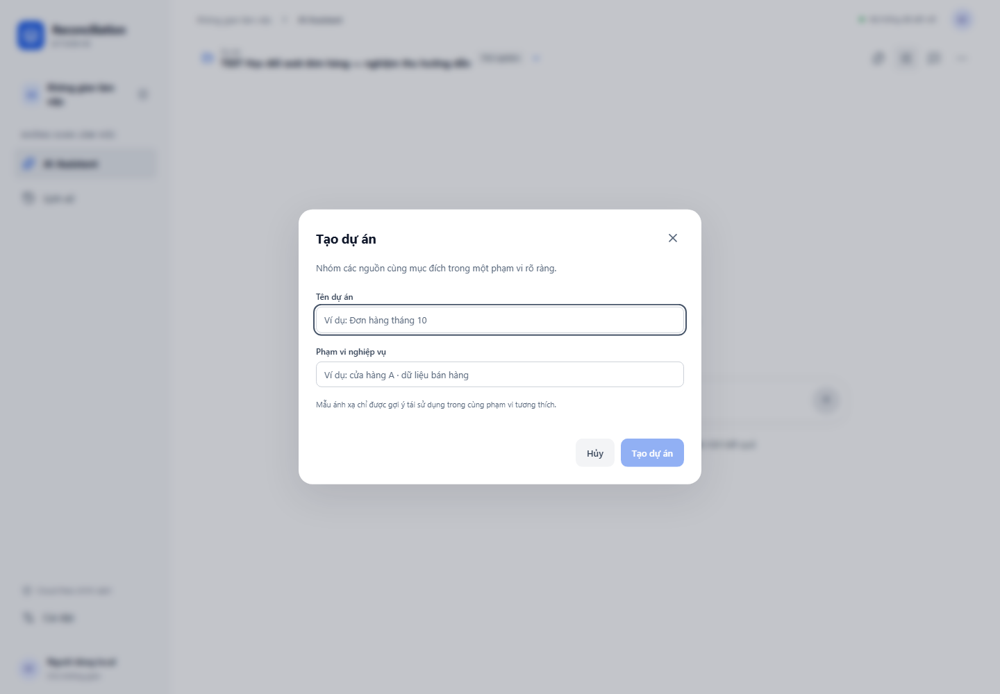

1. Mở <http://127.0.0.1:18180>. Chờ **Hệ thống đã kết nối**.
2. Bấm ô **Dự án** trên đầu Chat, chọn **Tạo dự án mới**.
3. Nhập **Tên dự án**: `TEST Học đối soát đơn hàng` và **Phạm vi nghiệp vụ**: `Thực hành dữ liệu tổng hợp tháng 10/2026`. Bấm **Tạo dự án**.
4. Mở lại ô Dự án, mở **Phân loại dự án hiện tại**, ở **Nhóm dự án** chọn **Kiểm thử**, bấm **Xác nhận phân loại**. Trên ô chọn sẽ có nhãn Thử nghiệm; đây chỉ là nhãn nhận biết, không chứng minh dữ liệu đã được xử lý.
5. Bấm dấu **+** bên trái ô nhập, chọn cả hai tệp A CSV và B XLSX. Kiểm tra hai tên tệp đang đính kèm.
6. Nhập yêu cầu sau rồi bấm mũi tên gửi **một lần**:

   > Kiểm tra hai tệp vừa tải lên, cho tôi biết số dòng, các cột dữ liệu và những vấn đề cần chú ý.

7. Theo dõi tiến độ ở cuối Chat. Nếu AI bị giới hạn hoặc yêu cầu bị chặn, đọc thông báo và dùng phần kiểm tra thủ công ở bước tiếp theo; không bấm gửi liên tục.
8. Bấm **Tệp đã tải**, chọn A. Kiểm tra bảng CSV có 25 dòng; chọn B, chọn sheet **Giao dịch**, kiểm tra 24 dòng. Phân trang nếu cần.
9. Bấm **Tải tệp gốc** nếu muốn kiểm tra tệp đã lưu. Việc tải không chuẩn hóa lại dữ liệu.
10. Nhấn Escape để đóng cửa sổ và về Chat.

**Đạt:** đúng dự án, đủ hai tên tệp, đủ số dòng, mã còn số 0 đầu và chưa nhầm “đã đọc” với “đã chuẩn hóa”. Nếu thất bại, giữ thông báo và tên dự án để báo lỗi; không xóa dữ liệu.

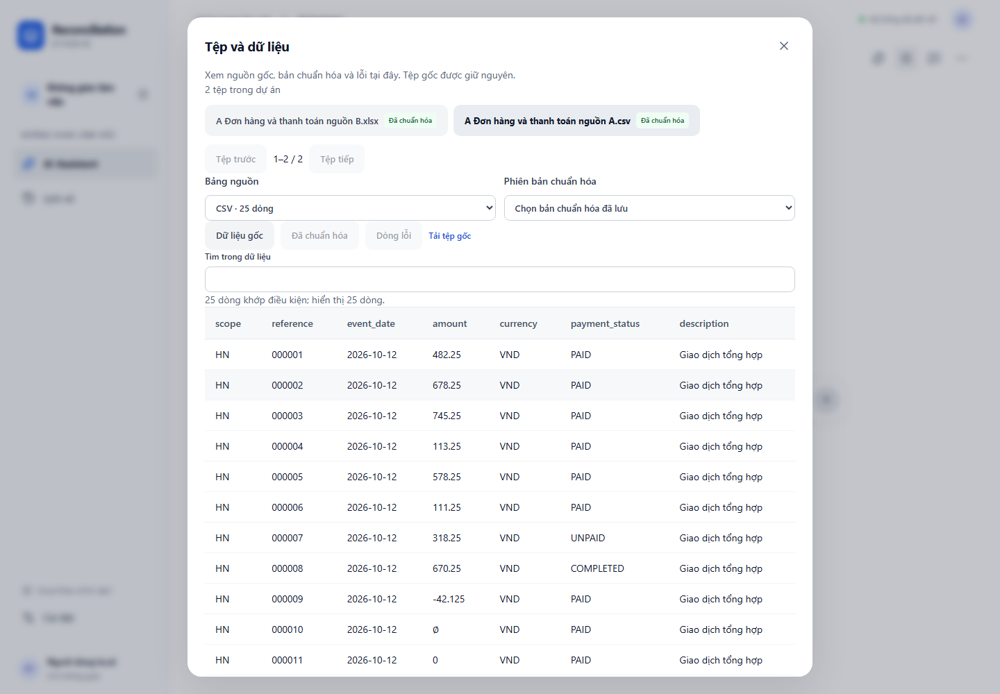

## 5. Kiểm tra và duyệt cách chuẩn hóa

### 5.1. Yêu cầu bằng hội thoại

Chọn đúng dự án, tải các tệp rồi gửi một lần:

> Hãy kiểm tra và chuẩn hóa các bộ dữ liệu này.

Chờ thẻ **Quyết định cần xác nhận** cho từng bảng. Mỗi thẻ ghi tên tệp/sheet, tổng số cột, số trường đã kiểm kỹ thuật và số trường cần xác nhận. Đề xuất không phải phê duyệt. Nếu chưa đủ dữ kiện, cung cấp thông tin được hỏi hoặc mở **Bổ sung bằng tiếng Việt**; nội dung được diễn giải thành bản xem lại và bạn vẫn phải quyết định.

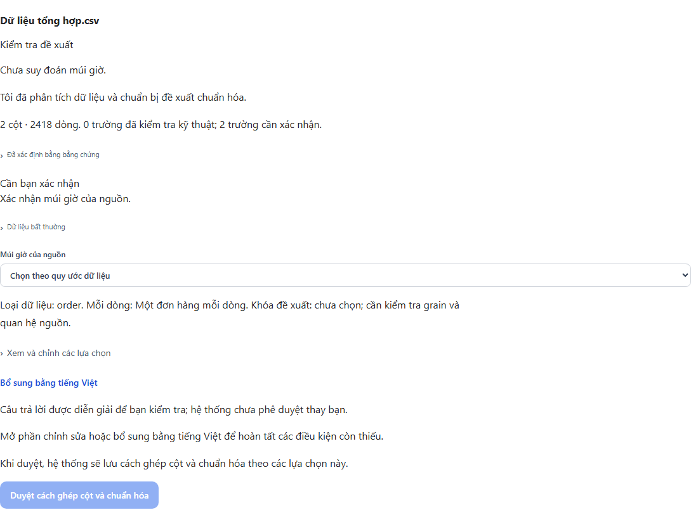

Ảnh trên chụp hồi quy trình duyệt với đề xuất tổng hợp giả lập, dùng để minh họa bố cục. Trạng thái AI LIVE của các lượt kiểm thử thật xem trong [báo cáo triển khai](IMPLEMENTATION_STATUS.md).

### 5.2. Xem kết quả kiểm tra và duyệt

1. **Đã xác định bằng bằng chứng**: mở khi cần đối chiếu kiểu dữ liệu và các phép chuyển đổi đã kiểm. Không phải nhập lại định dạng ngày/số nếu hệ thống đã điền đúng.
2. **Cần bạn xác nhận**: trả lời đúng thông tin còn thiếu. Ví dụ, chọn **Múi giờ của nguồn** một lần cho các cột ngày còn thiếu múi giờ. `2026-10-10` tự nó không cho biết thuộc UTC hay Việt Nam. Ngày lịch được biểu diễn bằng nửa đêm trong vùng đã xác nhận rồi lưu UTC; đối chiếu ngày sau khi xem lại theo vùng đã chọn.
3. **Dữ liệu bất thường**: xem số dòng lỗi và loại lỗi. Nếu có nhiều tiền tệ, trường tiền hiện cần một đơn vị đã xác nhận. Chọn theo phạm vi dùng thật; giá trị tiền tệ khác vẫn còn trong nguồn và được báo riêng, không tự quy đổi hoặc bỏ dòng.
4. **Quan hệ tiềm năng giữa các nguồn**, nếu có: xem số khóa chung, trùng và thiếu. Hai cột cùng tên hoặc nhiều khóa giống nhau chưa đủ để quyết định mỗi dòng là gì hay dùng một-một/một-nhiều. Mã khách hàng không mặc định là khóa giao dịch.
5. Mở **Xem và chỉnh các lựa chọn** nếu cần thay kiểu, chỉ tiêu, cơ sở số tiền, khóa hoặc cách đọc. Khi sửa, chờ hệ thống kiểm lại. Nếu toàn bộ giá trị của một cột không chuyển được, kiểm lại quy tắc trước khi duyệt; không coi cả cột nguồn là hỏng.
6. Đọc thông báo **Đã kiểm tra trước chuẩn hóa** và số dòng dự kiến lỗi. Nếu có xác nhận vùng bảng/cảnh báo nguồn, chỉ tích sau khi đã kiểm tra. Bấm **Duyệt cách ghép cột và chuẩn hóa** một lần khi đã hiểu và đồng ý. Lặp lại từng nguồn; phê duyệt một tệp không duyệt thay tệp khác.
7. Vào **Tệp đã tải**, chọn tệp/sheet và **Phiên bản chuẩn hóa** vừa tạo. Chọn **Đã chuẩn hóa** để xem kết quả, **Dòng lỗi** để truy đúng giá trị gốc và số dòng.

Nếu Gemini đang không khả dụng, dùng đường thủ công bên dưới. Khi chưa rõ dịch vụ đã nhận yêu cầu, giữ lịch sử và theo dõi công việc; không gửi lặp.

Các lựa chọn tham chiếu khi cần sửa đề xuất của bộ A trong mục 3:

| Cột nguồn | Cách xác nhận |
| --- | --- |
| scope | Văn bản; thành phần khóa |
| reference | Văn bản; thành phần khóa; giữ `000001`, không chuyển sang số |
| amount | Số tiền; chỉ tiêu `reported_transaction_amount`; cơ sở `gross`; tiền tệ và đơn vị `VND`; định dạng `1,234.56` |
| event_date | Ngày; định dạng `2026-10-31` tương ứng `%Y-%m-%d`; múi giờ `UTC` |
| currency | Văn bản; mã tiền tệ trong nguồn |
| payment_status | Trạng thái gốc; COMPLETED và EXPECTED không mặc định là PAID |
| description | Văn bản; không thực thi nội dung giống công thức hoặc chỉ thị |

### 5.3. Đường thủ công khi AI không khả dụng

Ảnh màn hình kiểm tra ánh xạ của bộ A sau khi đã được xác nhận; không phải đề xuất AI chưa duyệt:

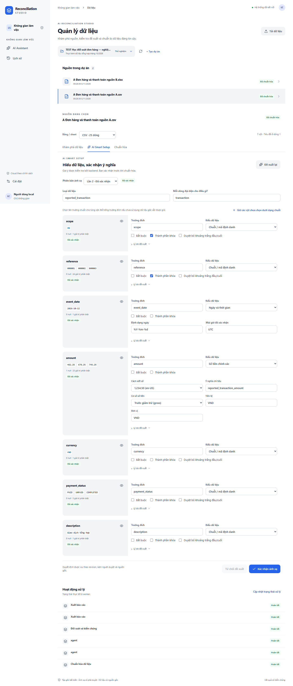

Không cần đổi API key hoặc mở quyền mới để kiểm tra dữ liệu:

1. Bấm **Tệp đã tải**, chọn tệp cần làm.
2. Mở **Kiểm tra thủ công khi cần** → **Mở kiểm tra và ánh xạ thủ công**.
3. Chọn **Bảng / sheet**: CSV cho A, Giao dịch cho B.
4. Mở tab **AI Smart Setup**. Dù tên tab có AI, bạn có thể tự xác nhận các cột đang có mà không gửi yêu cầu mới tới dịch vụ AI.
5. Nhập loại dữ liệu `reported_transaction`, mỗi dòng `transaction`.
6. Với từng cột, nhập **Trường đích** giống tên cột trong bảng trên. Chọn kiểu văn bản/số tiền/ngày. Tích **Thành phần khóa** cho scope và reference.
7. Ở amount: Locale `en-US`, Chỉ tiêu `reported_transaction_amount`, Cơ sở `gross`, Tiền tệ `VND`, Đơn vị `VND`.
8. Ở event_date: định dạng `%Y-%m-%d`, múi giờ `UTC`. Kiểm tra cảnh báo nếu có.
9. Chờ thông báo **Đã kiểm tra … dòng**. Xem số dòng dự kiến lỗi, sửa lại trường chưa đúng nếu có. Bấm **Xác nhận ánh xạ** khi nút bật; chờ **Đã cập nhật ánh xạ.**
10. Mở tab **Chuẩn hóa** → **Chuẩn hóa dữ liệu**. Chờ kết quả, kiểm tra đủ 25 hoặc 24 dòng. Lặp lại với tệp còn lại.
11. Bấm **AI Assistant** ở thanh bên để về Chat.

### 5.4. Hỏi trạng thái và kiểm tra lỗi

Nếu vừa trở về từ màn hình kiểm tra một tệp, bấm **Đổi ngữ cảnh phân tích** trên thanh công cụ Chat. Khi thấy **Nguồn đang xem**, bấm **Dùng dữ liệu của dự án** để hỏi về cả hai nguồn. Thao tác này mở hội thoại theo phạm vi dự án; hội thoại và bản nháp riêng của tệp vẫn được giữ. Nếu đang ở phạm vi một nguồn mà hỏi “hai bộ dữ liệu”, hệ thống sẽ yêu cầu chọn lại phạm vi, không trả lời một nguồn như thể đã kiểm tra hai nguồn.

Gửi câu sau — đây cũng là kiểm thử lại lỗi đã báo:

> Hai bộ dữ liệu đã được chuẩn hóa chưa?

Kết quả phải phân biệt từng nguồn dựa vào metadata hiện tại:

- Chưa có tệp: hướng dẫn tải tệp.
- Chỉ đã đọc: nói chưa chuẩn hóa, cần xác nhận ghép cột.
- Một nguồn xong: nêu nguồn nào xong và nguồn nào còn chờ.
- Cả hai READY: nói đã chuẩn hóa, có thể xem dữ liệu hoặc thiết lập đối soát; không nói đã đối soát.
- Một phần: nêu còn dòng không hợp lệ cần kiểm tra.
- Bản cũ: nói cần kiểm tra ánh xạ/phiên bản và chuẩn hóa lại.
- Có nhiều nguồn mơ hồ: hỏi chọn nguồn, không tự chọn hai tệp đầu tiên.

Bấm **Tệp đã tải** → chọn nguồn và **Bảng nguồn** → ở **Phiên bản chuẩn hóa**, chọn bản đã lưu đúng số dòng và không có nhãn **đã cũ** → bấm **Đã chuẩn hóa** để đối chiếu. Khi chưa chọn phiên bản, nút Đã chuẩn hóa và Dòng lỗi bị khóa; đây không có nghĩa mất bản chuẩn hóa. Khi đổi tệp/sheet, chọn lại phiên bản của nguồn mới. Chọn **Dòng lỗi** nếu cần kiểm tra lỗi. Ô tiền trống của mã 000010 vẫn phải là thiếu giá trị, không tự thành 0.

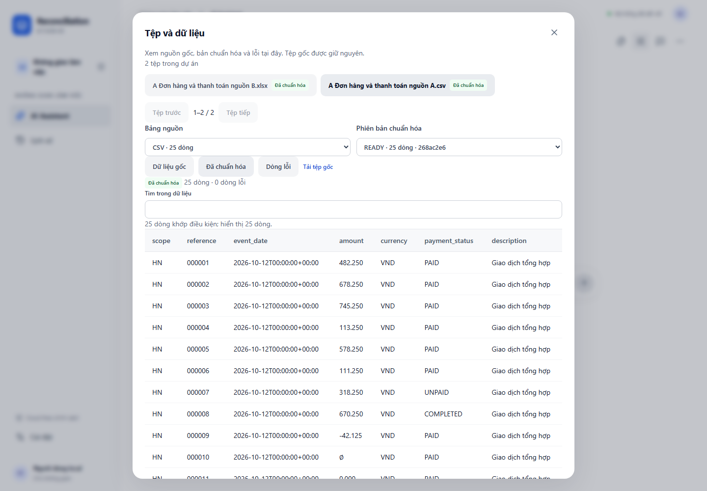

Ví dụ câu hỏi trạng thái trên bộ G 1.000 giao dịch, cũng đã có hai nguồn READY; câu trả lời chỉ xác nhận chuẩn hóa:

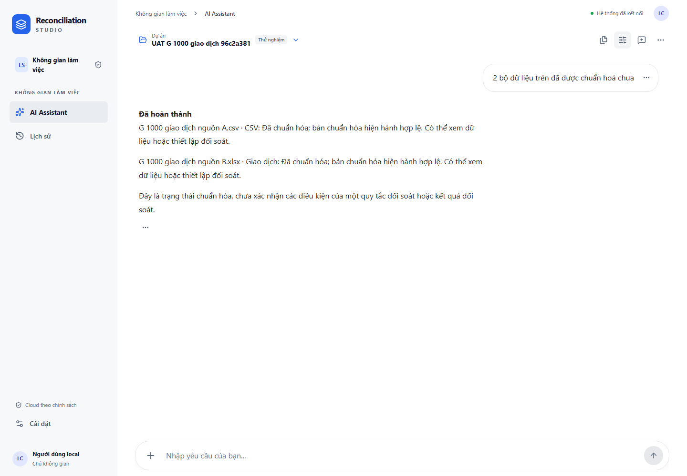

## 6. Đối soát hai nguồn

### 6.1. Yêu cầu AI chuẩn bị quy tắc

Gửi:

> Hãy đối soát hai bộ dữ liệu đã chuẩn hóa theo mã giao dịch và so sánh số tiền. Nếu thiếu điều kiện quan trọng, hãy hỏi tôi trước khi chạy.

Với fixtures này, thông tin đã biết để trả lời bổ sung là:

> Nguồn trái A CSV, nguồn phải B XLSX. Ghép scope và reference, một-một, không gộp dòng trùng. So amount theo reported_transaction_amount gross VND, giữ dấu, sai số 0. Dùng event_date là ngày phát sinh, múi giờ UTC. Kỳ từ 2026-10-01 đến trước 2026-11-01. Hai nguồn đầy đủ trong kỳ này, chốt tại 2026-11-02T00:00:00Z. Quy tắc hiệu lực từ 2026-10-01. Cho tôi xem và duyệt trước khi chạy.

Không dùng mô tả này cho dữ liệu thật nếu bạn chưa xác nhận kỳ, độ đầy đủ và ý nghĩa số tiền.

Trên thẻ quy tắc, kiểm tra đúng hai tên nguồn, khóa, tiền tệ, sai số và kỳ. Mở **Kiểm tra phạm vi và chỉnh quy tắc** khi cần. Bấm nút **Duyệt quy tắc và đối soát** chỉ khi mọi lựa chọn đã đúng. Nếu không có đủ đề xuất hợp lệ, bổ sung thông tin hoặc dùng thiết lập thủ công.

### 6.2. Đường đối soát thủ công

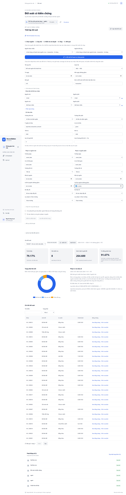

1. Mở dấu ba chấm trên thanh công cụ Chat → **Thiết lập đối soát thủ công**.
2. Chọn **Nguồn tham chiếu** A và **Nguồn đối ứng** B, đúng bản chuẩn hóa hiện hành.
3. Kiểm tra các khóa scope/reference và chỉ tiêu tiền đã được xác nhận.
4. Chọn **Quan hệ** một-một. **Đơn vị đối soát (mỗi nhóm đại diện cho)** là `transaction`.
5. **Từ ngày** `2026-10-01`; **Đến ngày (không gồm)** `2026-11-01`; **Múi giờ** `UTC`; **Sai số tuyệt đối** `0`.
6. Trong **Phạm vi nguồn trái** và **Phạm vi nguồn phải**: Trường ngày `event_date`, đầu kỳ `2026-10-01`, cuối kỳ không gồm `2026-11-01`, độ đầy đủ **Đã xác nhận đầy đủ**. Kiểm tra thời điểm chốt và ý nghĩa ngày theo các thông tin vừa nêu.
7. Có thể chọn cho phép kết quả một phần để giữ các nhóm cần kiểm tra; điều này không biến nhóm lỗi/mơ hồ thành khớp.
8. Tích **Tôi xác nhận kỳ, múi giờ và phạm vi nguồn**, bấm **Kiểm tra điều kiện**.
9. Đọc thông báo kiểm tra, bấm **Lưu đề xuất thủ công**. Trong **Review trước khi chạy**, kiểm tra lại hai nguồn, khóa, chỉ tiêu, kỳ và múi giờ.
10. Nếu nguồn có dòng lỗi chuẩn hóa, xem số dòng bị tách và kiểm tra danh sách lỗi trong phần dữ liệu. Khi đồng ý đối soát phần hợp lệ, đánh dấu **Tôi đã kiểm tra dòng lỗi và xác nhận đối soát phần dữ liệu hợp lệ**. Bấm **Xác nhận quy tắc và dấu số tiền** để phê duyệt. Sau thông báo đã duyệt, bấm **Chạy đối soát đã duyệt** và chờ kết quả.
11. Chờ công việc hoàn tất. Nếu bị chặn, đọc lý do; không thay tiền tệ/khóa hoặc hạ điều kiện chỉ để chạy được.

## 7. Đọc và kiểm chứng kết quả

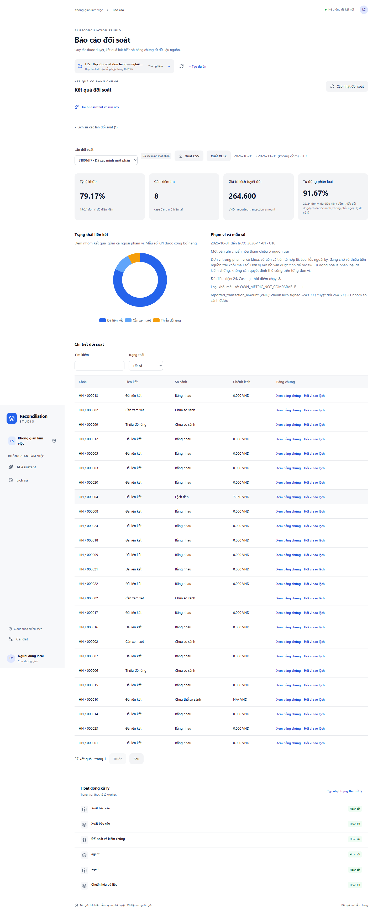

Mở **Xem kết quả** trên thẻ kết quả hoặc báo cáo của lần đối soát vừa chạy. Đối chiếu bảng đáp án ở mục 3.

- **Khớp hoàn toàn:** cùng khóa được liên kết và số tiền bằng nhau theo quy tắc.
- **Lệch tiền:** đã liên kết được hai phía nhưng số tiền khác nhau; không biến thành hai giao dịch thiếu đối ứng.
- **Thiếu đối ứng:** chỉ thấy một phía trong phạm vi đã xác nhận; nếu nguồn chưa đủ kỳ phải phân biệt đang chờ với thiếu thực sự.
- **Mơ hồ:** có nhiều khả năng ghép, ví dụ mã trùng; hệ thống cần kiểm tra, không tự chọn dòng thuận tiện.
- **Không đủ điều kiện so sánh:** ví dụ một phía thiếu tiền hoặc ý nghĩa tiền không tương thích; không được coi ô thiếu là 0.
- **Chưa đánh giá:** nhóm chưa thể đưa ra kết luận so tiền; không phải khớp.
- **Đã xác minh:** bộ kiểm chứng độc lập kiểm tra phân nhóm, bảo toàn số tiền và bằng chứng trong phạm vi kết quả.
- **Xác minh một phần:** còn phần bị loại/chưa đủ điều kiện; đọc cảnh báo và phạm vi, không áp kết luận cho toàn bộ dữ liệu.

Tỷ lệ khớp là số nhóm đủ điều kiện khớp chia cho số nhóm đủ điều kiện trong phạm vi mà báo cáo nêu. Đây không phải độ chính xác của AI. Kiểm tra cả tử số, mẫu số và các phần bị loại. Mẫu số bằng 0 phải là không áp dụng, không phải 100%.

Tổng chênh lệch có dấu có thể triệt tiêu giữa số dương và âm. Tổng tuyệt đối cộng độ lớn từng chênh lệch so được. Với bộ A, hai nhóm lệch 7,35 và −257,25 cho tổng có dấu −249,90 và tổng tuyệt đối 264,60 VND. Tiền nhóm thiếu/mơ hồ/không so được không tự cộng vào tổng này.

Một số bảng/báo cáo giữ chuỗi số chính xác với **dấu chấm thập phân**, giống định dạng tệp thực hành: `264.600` nghĩa là **264,600 VND**, không phải 264.600 đồng theo cách dùng dấu chấm phân cách hàng nghìn. Không tự làm tròn ba chữ số thập phân thành số nguyên; kiểm tra đơn vị và dữ liệu nguồn khi đọc.

## 8. Hỏi về kết quả, bảng, biểu đồ và bằng chứng

Trước khi hỏi, bấm **Đổi ngữ cảnh phân tích**, chọn đúng kết quả của dự án và kỳ. Nếu đổi kết quả, kiểm tra tên/kỳ lại; không mặc định câu trả lời cũ đã cập nhật.

| Câu có thể sao chép | Cần kiểm tra ở đâu và điều kiện đạt |
| --- | --- |
| Có bao nhiêu giao dịch khớp? | Đọc tổng từ kết quả đang chọn; bộ A có 19 nhóm EQUAL, không phải số dòng nguồn |
| Có bao nhiêu giao dịch lệch tiền? | Bộ A có 2 nhóm; A 25 dòng không có nghĩa 25 nhóm đều so được |
| Tổng chênh lệch là bao nhiêu? | Phải nói rõ có dấu hoặc tuyệt đối, tiền tệ và phạm vi; đối chiếu −249,90 / 264,60 VND |
| Cho tôi xem ba giao dịch lệch lớn nhất. | Bộ A chỉ có 2 nhóm lệch; không bịa nhóm thứ ba. Xem tổng số, sort và dấu tiền |
| Giải thích giao dịch thứ hai. | Dùng đúng trang/sort bảng vừa xem; mở bằng chứng, không suy diễn phí hoặc nguyên nhân chưa có chứng cứ |
| Hiển thị biểu đồ theo trạng thái. | Tổng các nhóm trong biểu đồ phải phù hợp population được ghi; trạng thái thanh toán khác trạng thái đối soát |
| Cho tôi xem dòng dữ liệu nguồn. | Chọn nhóm/dòng rõ ràng rồi mở Xem dòng gốc; đúng tệp, sheet, mã và dòng |
| Xuất kết quả đối soát đang xem ra Excel. | Chờ liên kết tải của đúng kết quả; không nhầm với tệp gốc |

Nếu cần hỏi bổ sung về nguồn/chỉ tiêu, trả lời đúng lựa chọn đang hiện. Không chọn nguồn gần giống tên hoặc tự dùng kết quả mới nhất của một dự án khác.

Trong bảng Chat, bấm tiêu đề cột để sắp xếp nếu cần. Bấm **Xem đầy đủ dữ liệu** để xem đầy đủ trang hiện hành, **Trước / Tiếp** để đổi trang. Tổng/đếm áp dụng toàn bộ dữ liệu thỏa điều kiện, không chỉ 10 dòng xem trước. Đóng bảng bằng Escape; vị trí đọc Chat được giữ khi bạn đang xem phần trước.

Để kiểm chứng bằng chứng khi AI tạm thời không khả dụng:

1. Trong báo cáo của đúng lần đối soát, tìm bảng **Chi tiết đối soát** bên dưới các chỉ số và biểu đồ.
2. Dùng **Tìm kiếm** với mã `000004`; kiểm tra khóa `HN / 000004` và chênh lệch `7.350 VND`.
3. Trên chính dòng đó, bấm **Xem bằng chứng**. Không bấm **Hỏi vì sao lệch** nếu chỉ cần đọc tệp và số tiền gốc.
4. Trong cửa sổ bằng chứng, kiểm tra cùng mã `000004`, nguồn A có `113.25`, nguồn B có `105.90`, đúng tệp và dòng. Không tự quy chênh lệch này là phí hoặc gian lận.
5. Nhấn Escape để đóng. Tìm tiếp `000010` để thấy trường hợp thiếu tiền, rồi xóa tìm kiếm để xem lại danh sách. Chỉ số tổng vẫn thuộc toàn bộ phạm vi của lần chạy, không phải riêng dòng đang tìm.

## 9. Xuất và mở lại báo cáo

1. Mở kết quả vừa đối soát, kiểm tra kỳ và trạng thái xác minh.
2. Bấm **Xuất XLSX** hoặc **Xuất CSV**. Chờ tạo xong; không tải một liên kết cũ trước khi công việc hoàn tất.
3. Bấm **Tải báo cáo**, chọn nơi lưu.
4. Mở XLSX trong Excel. Kiểm tra phần Summary và các bảng chi tiết: đúng lần chạy, kỳ, tiền tệ, số nhóm và chênh lệch.
5. Với bộ A, kiểm tra 000004, 000011, ô thiếu tiền của 000010 và nhóm trùng 000002. Không kỳ vọng ô thiếu tự thành 0.
6. Kiểm tra mã có số 0 đầu. Nếu mở CSV bằng Excel làm mất số 0, nhập CSV với cột mã kiểu văn bản; đối chiếu tệp gốc và XLSX trước khi kết luận hệ thống mất mã.
7. Kiểm tra tiền âm vẫn là số âm hợp lệ. Text giống công thức phải được giữ an toàn, không thực thi như công thức từ dữ liệu không tin cậy.
8. So với màn hình của đúng lần chạy. Báo cáo là ảnh chụp kết quả đã lưu tại thời điểm đó; đổi quy tắc hoặc chuẩn hóa lại không sửa nội dung báo cáo cũ.

## 10. Đóng, mở lại và khôi phục kết nối

1. Nhập một bản nháp nhưng chưa gửi. Reload trang: bản nháp trong cùng tab/ngữ cảnh phải còn, chưa tự gửi.
2. Bấm **Lịch sử**, chọn hội thoại vừa dùng. Kiểm tra câu hỏi, câu trả lời, quyết định và kết quả còn đúng.
3. Mở bảng, bằng chứng và báo cáo cũ; kiểm tra mã và chênh lệch không thay đổi.
4. Khi mở lại hội thoại, mặc định xem phần mới nhất. Khi cần đọc trước đó, cuộn lên hoặc bấm **Xem tin nhắn cũ hơn**.
5. Nếu dịch vụ/máy vừa khởi động và trang báo cần kiểm tra local, người vận hành mở PowerShell tại thư mục dự án và chạy:

   ```powershell
   ./tools/start.ps1 -SkipBuild
   ```

6. Chờ xác minh xong rồi bấm **Thử kết nối lại** trên web. Khi source thay đổi cần build, người vận hành dùng `./tools/start.ps1`.

Không xóa database, cookies, tệp gốc hoặc Docker volumes để sửa kết nối. Không gửi lại câu đang xử lý chỉ vì reload hoặc chưa thấy trả lời ngay.

## 11. Lỗi thường gặp và cách xử lý an toàn

| Dấu hiệu | Nguyên nhân có thể | Cách kiểm tra và xử lý |
| --- | --- | --- |
| Không kết nối / cần kiểm tra local | Docker vừa khởi động hoặc xác minh cũ hết hiệu lực sau recreate | Dùng bước khởi động ở mục 10, rồi Thử kết nối lại; giữ dữ liệu |
| AI đang chờ | Công việc đã nhận nhưng chưa kết thúc, hoặc chờ người dùng | Xem tiến độ/thẻ yêu cầu; dùng Cập nhật hội thoại, không gửi lặp |
| Chưa đủ bằng chứng | Chưa chọn kết quả đã xác minh hoặc chưa đủ dữ kiện | Kiểm tra ngữ cảnh; hỏi trạng thái nguồn nếu chỉ cần biết chuẩn hóa, không ép kết luận tiền |
| Chưa chuẩn hóa | Mới đọc tệp hoặc chưa duyệt ghép cột | Kiểm tra từng tệp, duyệt đúng ánh xạ, thực hiện chuẩn hóa |
| Chờ phê duyệt | Đề xuất chưa có quyết định của người có quyền | Mở thẻ kiểm tra rồi dùng nút duyệt ghi rõ tác động; Chat không tự phê duyệt |
| AI đang giới hạn yêu cầu / 429 | Nhà cung cấp áp quota hoặc tốc độ | Dừng các yêu cầu AI mới, dùng dữ liệu/kết quả đã lưu hoặc thiết lập thủ công; không đổi key/provider để né |
| Hết thời gian chờ / chưa rõ đã nhận yêu cầu | Chưa xác định được trạng thái giao tới dịch vụ | Cập nhật hội thoại, giữ lịch sử; không tự gửi lại một yêu cầu chưa rõ delivery |
| Không thấy kết quả | Job chưa xong, bị chặn hoặc đang xem sai dự án/run | Mở History, kiểm tra trạng thái và ngữ cảnh; phản hồi lỗi phải còn sau reload |
| Không tìm thấy nguồn | Đổi dự án, tên mơ hồ, nguồn cũ hoặc thiếu quyền | Chọn đúng dự án/tệp, trả lời câu hỏi bổ sung; không chọn nguồn gần giống |
| Không xuất được Excel | Chưa có kết quả hợp lệ, thiếu quyền hoặc tạo file chưa xong | Kiểm tra trạng thái run/job, đợi liên kết tải; không dùng tệp khác để thay kết quả |
| Không có quyền | Tài khoản chỉ được đọc hoặc quyền đã bị thu hồi | Liên hệ chủ không gian, không tìm cách bỏ qua nút bị vô hiệu hóa |
| Xử lý nền thất bại | Lỗi thực thi hoặc phục hồi worker đã hết số lần an toàn | Giữ thông báo, thời điểm, dự án và mã công việc trong Chi tiết hỗ trợ; liên hệ người vận hành |

Nếu bấm gửi một lần mà thấy hai yêu cầu, ghi lại thời điểm và mã công việc; không tự xóa lịch sử. Hai lần chủ động gửi cùng nội dung có thể là hai yêu cầu hợp lệ. Idempotency bảo vệ một lần gửi bị lặp do mạng, không ngăn người dùng chủ động hỏi lại sau khi kết thúc.

## 12. Phiếu tự nghiệm thu

Đánh dấu dựa vào quan sát thực tế, không chỉ vì AI nói đã xong:

- [ ] Đúng dự án TEST, hai tên tệp, A 25 dòng / B 24 dòng.
- [ ] Đã đọc khác đã chuẩn hóa; câu hỏi trạng thái có câu trả lời cho từng nguồn.
- [ ] Ghép đúng cột dù B đổi thứ tự; giữ số 0 đầu, tiền âm, ô trống và số 0 riêng biệt.
- [ ] Người dùng duyệt ánh xạ và quy tắc; AI không tự duyệt.
- [ ] Đúng hai nguồn, khóa scope/reference, một-một, VND, kỳ và độ đầy đủ đã xác nhận.
- [ ] Kết quả đúng oracle; phần mơ hồ/thiếu/không so được được giữ rõ.
- [ ] Tổng chênh lệch và số nhóm khớp màn hình, bảng, biểu đồ và file xuất.
- [ ] Mở đúng dòng nguồn của giao dịch được chọn.
- [ ] Gửi câu mới tự về cuối, đọc tin cũ không bị giật xuống, tải lịch sử giữ vị trí.
- [ ] Lỗi có thông báo hữu ích và còn khi mở lại; không gửi lặp ngoài ý định.
- [ ] Reload/History/bản nháp và kết quả cũ được giữ.

Kết quả nghiệm thu kỹ thuật, ảnh thực tế và các ca AI LIVE còn chặn được ghi tại [báo cáo triển khai](IMPLEMENTATION_STATUS.md). PASS local hoặc MOCK không chứng minh mọi câu tiếng Việt đều được AI hiểu đúng. Trạng thái phát hành phải căn cứ báo cáo của đúng revision đang chạy.

## 13. Kiểm thử bộ ba nguồn tháng 10/2026

Dùng ba tệp tổng hợp đã tải vào dự án **TEST Đối soát 3 nguồn tháng 10-2026**. Nếu muốn làm từ đầu, tải lại bản gốc qua **Tệp đã tải → Tải tệp gốc**, sau đó tạo dự án TEST mới. Không sửa tệp, không xóa bản chuẩn hóa cũ. Ba tệp này thuộc dữ liệu kiểm thử local và không đi kèm source GitHub.

| Tệp | Tổng dòng | Dòng hợp lệ sau chuẩn hóa | Dòng không hợp lệ | Lỗi ngày thật |
| --- | ---: | ---: | ---: | ---: |
| `01_don_hang_du_kien_2400.csv` | 2.418 | 2.408 | 10 | 2 |
| `02_su_kien_thanh_toan_2685.xlsx` | 2.685 | 2.674 | 11 | 5 |
| `03_sao_ke_ngan_hang_theo_lo.csv` | 384 | 380 | 4 | 0 |

1. Tải cả ba tệp; kiểm tổng 5.487 dòng. Xác nhận ngày `%Y-%m-%d` và UTC theo quy ước của bộ thử. Với tệp 01 đã có ánh xạ được duyệt, người vận hành có thể chạy **Chuẩn hóa dữ liệu** để tạo bản `normalization-2`; giữ bản cũ để đối chiếu. Không cần duyệt lại chỉ vì cách hiển thị `YYYY-MM-DD` đã được bộ chuyển đổi hiểu đúng.
2. Trong **Dòng lỗi**, kiểm tra các lỗi còn lại thuộc `EDGE_CASE`; các dòng `MAIN_VND` đã kiểm không còn lỗi. Một dòng có thể có nhiều lỗi/cảnh báo; số bản ghi lỗi có thể lớn hơn số dòng không hợp lệ. Kiểm tra USD giữ nguyên giá trị gốc, không được tính như VND.
3. Ở nguồn 01, `scope + reference` nhận diện đơn dự kiến; `customer_code` là mã khách hàng. Ở nguồn 02, mỗi dòng là sự kiện thanh toán; giữ `payment_id`, `reference`, `batch_id`, tiền âm và trạng thái gốc. Nguồn 03 là một dòng theo lô sao kê; `gross_amount`, `net_amount` và `fee_amount` là ba cột riêng. Không dùng net để so tổng gross.
4. Tạo hai quy tắc riêng theo mục 6. Chọn `scope = MAIN_VND` ở cả hai phía, tiền tệ VND, UTC, kỳ từ `2026-10-01` đến trước `2026-11-01`. Đáp án bên dưới dùng sai số tuyệt đối `0 VND`, quy tắc giữ dấu số tiền, có xác nhận nguồn đầy đủ trong kỳ. Nếu dùng sai số khác, số nhóm trong ngưỡng sẽ thay đổi.
5. Đối chiếu đáp án, mở **Xem bằng chứng**, rồi xuất CSV và XLSX cho từng lần chạy. Mở lại theo đúng lần đối soát, không dùng kết quả của cặp còn lại để kiểm tiền.

| Cặp | Khóa và quan hệ | Khớp hoàn toàn | Lệch tiền | Thiếu đối ứng | Tổng lệch có dấu / tuyệt đối |
| --- | --- | ---: | ---: | ---: | ---: |
| 01 ↔ 02 | `scope + reference`, một đơn ↔ nhiều sự kiện; cộng có dấu | 2.040 | 200 | 215 | 7.867 / 60.883 VND |
| 02 ↔ 03 | `scope + batch_id`, nhiều sự kiện ↔ một lô; so với gross | 323 | 40 | 31 | −8.306 / 11.812 VND |

Hai cặp thực hành thủ công đã đạt các số liệu trên. Trước và sau khi đổi khóa, Gemini đều nhận đúng yêu cầu, nhưng trả HTTP 503 tại bước tạo đề xuất ánh xạ. Khi gặp thông báo này, bạn có thể tiếp tục kiểm tra và duyệt ánh xạ thủ công theo mục 5.

## 14. Chọn model trong ô Chat

Mở **AI Assistant**. Bộ chọn ngay cạnh nút gửi có hai mục **Gemini 3.5 Flash Lite** và **Qwen 3:8B**. Phiên chưa lưu lựa chọn cá nhân dùng Gemini theo cấu hình hiện hành. Chọn Qwen nếu muốn dùng model trên máy. Mục không chọn được phản ánh quyền sử dụng hoặc tình trạng kết nối. Hội thoại giữ model đã dùng cho từng yêu cầu.

Khi chỉnh thẻ xác nhận, bấm **Lưu bản nháp** để tiếp tục ở màn hình khác. Trong phần **Dữ liệu**, tab **AI Smart Setup** hiển thị cùng thẻ nếu bảng đang chờ xác nhận. Nút **Mở trong hội thoại** dẫn tới đúng hội thoại của thẻ. Nếu hết hạn, bấm **Mở lại thẻ xác nhận** khi nguồn vẫn còn nguyên. Bấm **Duyệt cách ghép cột và chuẩn hóa** sau khi kiểm tra các lựa chọn và dự báo dòng lỗi.

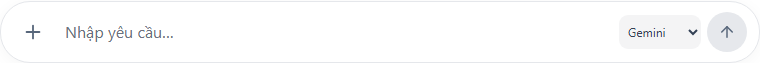

[Ảnh lịch sử của bộ chọn model trên điện thoại](images/user-guide/composer-model-mobile.png).

Bạn có thể đổi model khi đang xem lịch sử, đang soạn bản nháp hoặc sau khi job đã được nhận. Tin nhắn kế tiếp dùng lựa chọn mới. Việc đổi model giữ nguyên hội thoại, bản nháp và thẻ xác nhận đang mở. Một lần gửi chưa rõ đã được tiếp nhận sẽ giữ mã yêu cầu và model của lần gửi đó để bảo vệ khỏi xử lý trùng.

- “Các tệp đã được chuẩn hóa chưa?”
- “Hãy kiểm tra và đề xuất cách chuẩn hóa các bộ dữ liệu này.”
- “Cho tôi xem tổng quan kết quả đang mở.”
- “Mở bằng chứng của nhóm lệch thứ hai trong bảng vừa trả.”

Nếu Gemini báo giới hạn hoặc lỗi, bạn có thể chọn Qwen và gửi câu mới khi job trước đã kết thúc. Nếu Qwen hết thời gian hoặc chưa hiểu đúng nghiệp vụ, dùng đường duyệt thủ công ở mục 5.3. Các tác vụ chỉ đọc đã có đủ dữ kiện vẫn có thể do Backend xử lý trực tiếp.

## 15. Thử Smart Mapping Qwen với ba tệp

Lượt LIVE mới nhất tại [báo cáo mục AH](IMPLEMENTATION_STATUS.md#ah-khôi-phục-smart-mapping-với-qwen-local--05112026). Có thể mở dự án **TEST Qwen 8B — kiểm chứng ánh xạ** để đọc kết quả đã giữ trên máy. Các dự án thử cùng tên có thể thuộc những lượt thất bại trước; project của lượt đã duyệt là `510a220a-2e94-46be-9537-0940a115fa8b`. Để thử lại, tạo dự án TEST riêng và tải đúng ba tệp trong mục 13; không xóa các bản cũ.

1. Chọn **Qwen 3:8B**, đính kèm cả ba tệp trong cùng tin nhắn. Gửi “Tôi vừa tải dữ liệu lên. Hãy kiểm tra và đề xuất cách chuẩn hóa để tôi có thể đối soát.” Qwen đọc yêu cầu, chọn tác vụ và đề xuất ngữ nghĩa từng nguồn.
2. Chờ đủ ba thẻ **Quyết định cần xác nhận**, đúng tên nguồn, tổng 5.487 dòng. Lượt nghiệm thu mất khoảng 54 giây cho ba lần suy luận, chưa gồm thao tác người dùng. Máy thiếu RAM hoặc nạp model lại có thể lâu hơn. Không bấm gửi thêm vì đang chờ.
3. Đọc **Cần bạn xác nhận**, **Dữ liệu bất thường** và **Quan hệ tiềm năng**. Mở **Xem và chỉnh các lựa chọn** khi đề xuất chưa đúng. Với bộ tổng hợp này, cùng loại `order_financial_record`, grain lần lượt là `order`, `payment_event`, `settlement_batch`; khóa chuẩn hóa lần lượt `scope + reference`, `payment_id`, `scope + batch_id`. Không dùng customer_code làm khóa giao dịch; không dùng settlement_id thay batch_id của quan hệ đối soát theo lô.
4. Xác nhận `%Y-%m-%d`, UTC theo quy ước bộ thử. Các cột tiền dùng en-US, VND và đơn vị VND; amount/gross_amount là metric `reported_gross_amount`, basis gross; net_amount có metric/basis net riêng, fee_amount có metric/basis fee riêng. Đây là thông tin của bộ tổng hợp, không áp dụng mặc định cho tệp nghiệp vụ khác. Dòng USD vẫn giữ nguyên và báo khác tiền tệ.
5. Chờ thông báo kiểm tra toàn bảng sau mỗi chỉnh sửa. Khóa trong thẻ Chat là bắt buộc; dự kiến cần kiểm tra **12 / 11 / 6 dòng**, thêm bốn dòng thiếu mã so với cấu hình thủ công ở mục 13. Bản này dự kiến **5.458 hợp lệ / 29 cần kiểm tra**. Không bỏ khóa hoặc cảnh báo để ép về 25. Lỗi ngày thật vẫn 2 / 5 / 0.
6. Bấm **Duyệt cách ghép cột và chuẩn hóa** riêng từng nguồn khi đã kiểm tra. Mỗi nguồn có ánh xạ và kết quả riêng. Luồng kết thúc **Hoàn thành một phần** vì còn dòng lỗi; dùng **Kiểm tra dữ liệu trước/sau** để đọc từng dòng. AI không duyệt thay bạn.
7. Đối soát theo đúng hai hợp đồng mục 13: MAIN_VND, VND, UTC, tháng 10/2026, tolerance 0, cộng signed; 01 ↔ 02 theo scope/reference 1:N và 02 ↔ 03 theo scope/batch_id N:1, dùng gross. Duyệt quy tắc trước khi chạy. Hai kết quả mới vẫn đúng đáp án 2.040/200/215 và 323/40/31. Mở báo cáo, biểu đồ, **Xem bằng chứng**, rồi tải CSV/XLSX của đúng run.

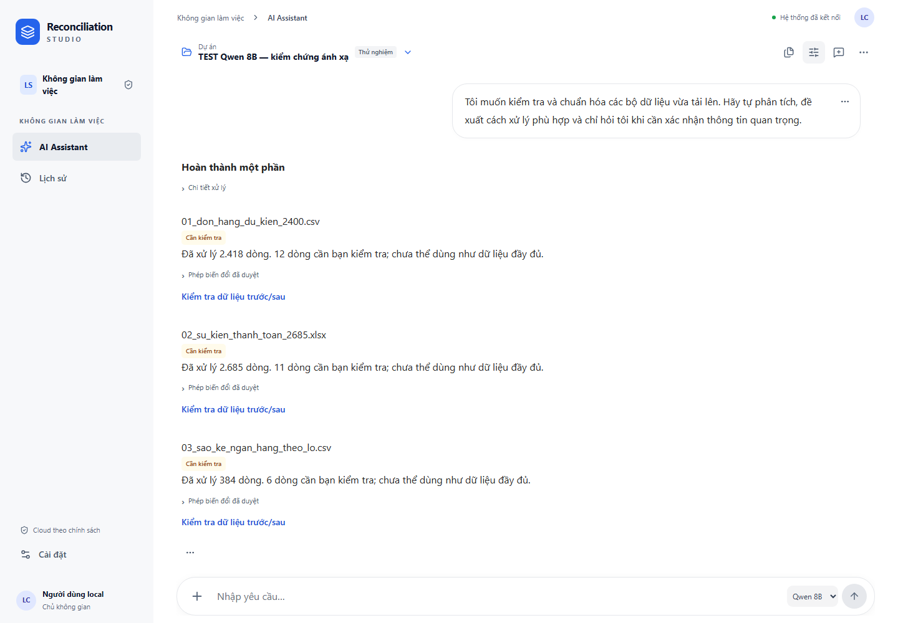

Nếu một nguồn lỗi tạo đề xuất, các thẻ đã tạo trước đó vẫn có thể duyệt. Đọc tên nguồn và thông báo của đúng job, dùng **Mở dữ liệu để ghép cột thủ công** cho phần còn lại. Không có fallback cloud tự động. Đổi model chỉ áp dụng cho lần gửi sau; lần gửi chưa rõ phản hồi giữ payload và model ban đầu. Gemini vẫn có HTTP 503 trong vòng cuối và chưa được coi ổn định dù khóa mới đã nhận HTTP 200.
